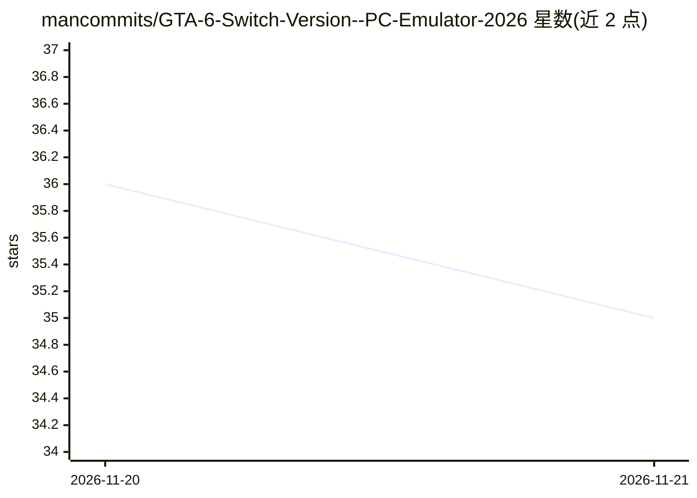

# mancommits/GTA-6-Switch-Version--PC-Emulator-2026

⭐ — · [GitHub]() · 个人维护

**面向 Windows 玩家的 GTA VI PC 版安装准备与配置指南**

一个面向 Windows 10/11 玩家的 GTA VI PC 版准备资源：覆盖 Windows 系统更新、GPU 驱动（NVIDIA/AMD/Intel）验证、存储检查、Rockstar Games Launcher 准备、图形设置与 FPS/卡顿/显示问题排查等内容。README 明确说明其安装器不含 GTA VI 游戏文件，游戏需经授权渠道另行购买；官方 PC 配置与发售日期尚未公布，系统需求表各项目均标注未确认。页面末尾附 SEO 关键词区块。

## 筛选速览

| 维度 | 判定 | 备注 |
|---|---|---|
| AI 角色 | `ai-enhanced` | 去掉 AI 部分产品仍成立 |
| 许可风险 | `permissive` | — |
| 部署形态 | `desktop` | 安装包/桌面程序 |
| 模型依赖 | — | README 未给出锁定关系 |
| 硬件要求 | — | 无带数字的原话,不猜 |
| 安装摩擦 | `low` | 无编译、无系统依赖或容器化 |
| 成熟度 | `idea` | |

## 能力要点

- Windows 兼容性准备清单（版本/DirectX/驱动/存储检查）
- 三显卡厂商官方驱动入口汇总
- FPS、卡顿、显示与安装错误的问题排查条目
- 图形设置科普（分辨率/纹理/阴影/光线追踪/上采样/帧生成）

## 适用场景

- 游戏发售前提前检查并更新 Windows 与显卡驱动环境
- 预留磁盘空间并准备 Rockstar Games Launcher
- 按排查清单处理 FPS 低、卡顿或显示异常问题

## 场景标签

 · 领域:游戏/安装与配置指南

## 证据(README 行号)

> L5: A dedicated PC installation and configuration resource for Grand Theft Auto VI, covering Windows preparation, graphi
> L49: The companion installer does not contain or install GTA VI game files.

## 星数曲线

2026-11-20 36 → 2026-11-21 35（-1）

---
*卡片 v1 · prompt 1.4 · 生成 2026-11-20 · 置信度 low · 依据 README sha `6954d37a13d3` · [字段定义](../../DATASET.md)*
