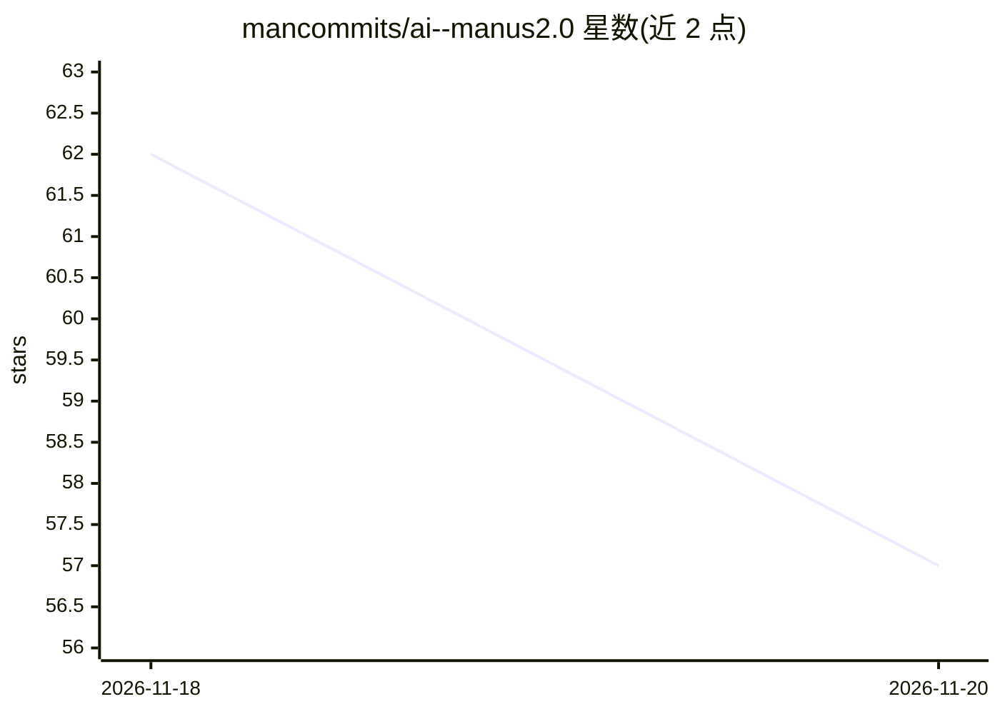

# mancommits/ai--manus2.0

⭐ 57 · Apache-2.0 · 推送 2026-11-19 · [GitHub](https://github.com/mancommits/ai--manus2.0) · 个人维护

**自主执行代码与浏览器操作的通用 AI Agent 助手**

一个面向终端用户的自主 AI Agent：用户描述任务后，agent 自行编写并执行脚本、控制浏览器导航网页、填写表单、收集信息，并以多步方式完成研究整理、提醒调度、文件检查等小规模任务。README 将定位设定为面向家庭、学习与轻量办公的个人助理，强调跨会话保持一致行为；兼容性要求为 64 位系统、双核 CPU、4GB 内存，浏览器控制需相应权限。README 未给出源码、安装命令或构建方式，仅提供下载入口。

## 筛选速览

| 维度 | 判定 | 备注 |
|---|---|---|
| AI 角色 | `ai-native` | 本体是模型或模型工具 |
| 许可风险 | `permissive` | Apache-2.0 |
| 部署形态 | `None` |  |
| 模型依赖 | — | README 未给出锁定关系 |
| 硬件要求 | — | 无带数字的原话,不猜 |
| 安装摩擦 | `low` | 无编译、无系统依赖或容器化 |
| 成熟度 | — | 结构信号不足 |

## 能力要点

- 自主编写并执行代码完成任务
- 控制浏览器导航、填表与信息收集
- 多步任务自动执行与跨会话模式沿用

## 适用场景

- 让 agent 自动收集多页网页信息做研究整理
- 把填表、查网页等重复性小事交给后台助手
- 快速运行脚本实验而不搭建完整环境

## 场景标签

`AI 助手` `浏览器自动化` · 领域:效率与自动化

## 证据(README 行号)

> L10: - **Autonomous Code Execution:** Manus AI agent runs code on its own to complete tasks, so you can focus on decisio
> L18: Manus is an autonomous AI agent designed to run code and control a browser on your behalf. Instead of acting like a
> L41: |**Memory (RAM)**|4 GB|8 GB or more for heavy Manus autonomous tasks|

## 星数曲线

2026-11-18 62 → 2026-11-20 57（-5）

---
*卡片 v1 · prompt 1.4 · 生成 2026-11-20 · 置信度 mid · 依据 README sha `202c1bf76f25` · [字段定义](../../DATASET.md)*
