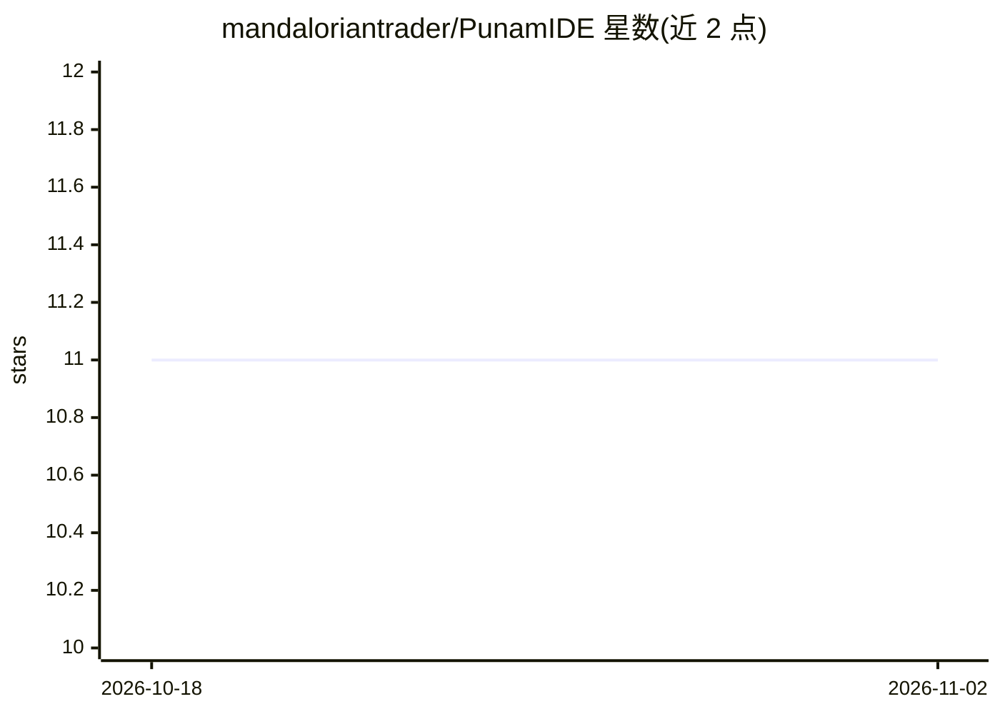

# mandaloriantrader/PunamIDE

⭐ 11 · TypeScript · MIT · 推送 2026-07-29 · [GitHub](https://github.com/mandaloriantrader/PunamIDE) · [官网](https://punamide.com) · 个人维护

**带多 Provider AI 助手的本地桌面代码编辑器（Tauri 2）**

基于 Tauri 2、React 19 与 Monaco Editor 的开源桌面 IDE：原生 Rust 后端、真实 PTY 终端、Git/GitHub 管理、DAP 调试器、LSP、Tree-sitter 符号索引等技术债分析与架构依赖图等 IDE 功能。AI 部分：BYOK 多 Provider 接入（应用内 Settings→Providers 配置 API key）、agentic 工具调用与多 Agent 系统、本地 embeddings/RAG、AI 测试生成。当前仅提供 Windows 安装包，标注 alpha，macOS/Linux 计划中；也可从源码构建。

## 筛选速览

| 维度 | 判定 | 备注 |
|---|---|---|
| AI 角色 | `ai-enhanced` | 去掉 AI 部分产品仍成立 |
| 许可风险 | `permissive` | MIT |
| 部署形态 | `desktop` | 安装包/桌面程序 |
| 模型依赖 | — | README 未给出锁定关系 |
| 硬件要求 | — | 无带数字的原话,不猜 |
| 安装摩擦 | `low` | 无编译、无系统依赖或容器化 |
| 成熟度 | `idea` | |

## 能力要点

- 多 Provider BYOK 接入，API key 在应用内配置
- 多 Agent 系统支持自主读/写/重构代码库
- 技术债分析与架构依赖图（Rust 后端）
- 真实终端、Git 集成、DAP 调试器等完整 IDE 功能

## 适用场景

- 在本地桌面环境中用 AI Agent 辅助读写和重构代码
- 查看并量化项目技术债与架构依赖关系
- 在一个 IDE 内完成 Git/GitHub 管理与调试

## 场景标签

`多智能体` `编码 Agent` · 领域:Agent 开发

## 证据(README 行号)

> L7: **A native AI-powered code editor built with Tauri 2, React 19, and Monaco Editor.**
> L29: > PunamIDE is an open-source desktop IDE , it's a full desktop IDE with a native Rust backend, real terminal, Git i

## 星数曲线

2026-10-18 11 → 2026-11-02 11（+0）

---
*卡片 v1 · prompt 1.4 · 生成 2026-11-02 · 置信度 mid · 依据 README sha `01f7bc97a9c4` · [字段定义](../../DATASET.md)*
