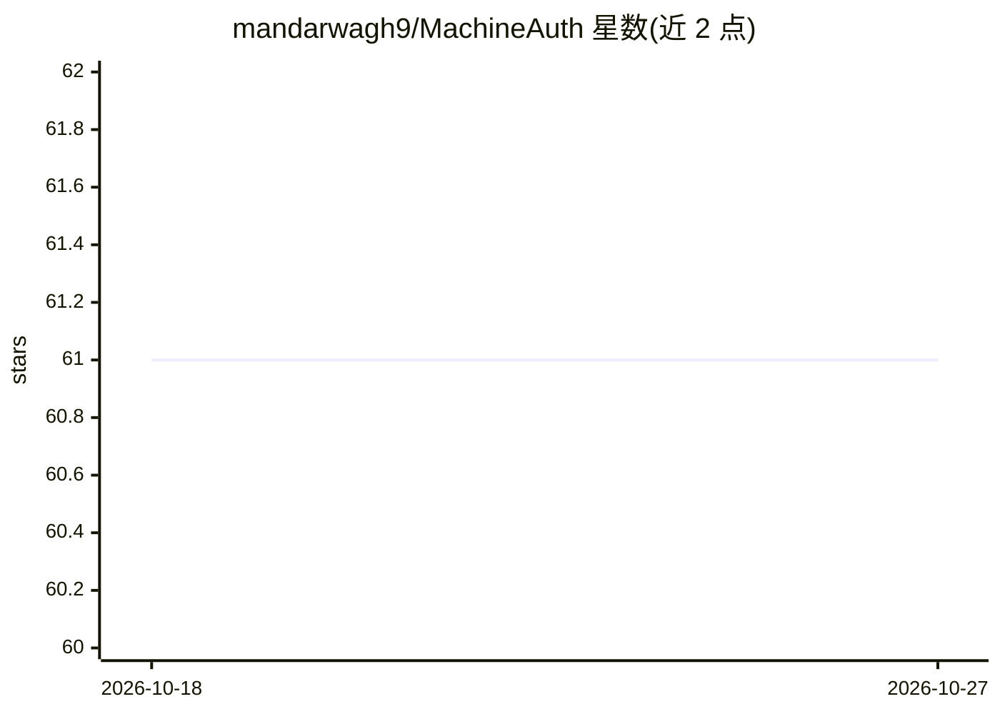

# mandarwagh9/MachineAuth

⭐ 61 · Go · MIT · 推送 2026-03-25 · [GitHub](https://github.com/mandarwagh9/MachineAuth) · [官网](https://machineauth.vercel.app/) · 个人维护

**面向 AI agent 的 OAuth 认证与权限基础设施**

自称『AI agent 的 OAuth』：为自主调用 API 的 AI agent 提供身份认证、细粒度权限与访问控制。核心机制包括 OAuth 2.0 Client Credentials 流程、RS256 JWT 短期令牌、令牌内省/撤销/刷新、JWKS 端点、凭据零停机轮换、多租户组织/团队隔离、webhook 事件通知与审计日志。以 Go 单二进制提供服务，默认 JSON 文件存储、无需数据库，生产环境推荐 PostgreSQL；附带 React 18 + TypeScript 管理面板，并提供 TypeScript 与 Python 官方 SDK。

## 筛选速览

| 维度 | 判定 | 备注 |
|---|---|---|
| AI 角色 | `ai-ecosystem` | LLM/agent 周边工具 |
| 许可风险 | `permissive` | MIT |
| 部署形态 | `self-host` | docker 或自建部署 |
| 模型依赖 | — | README 未给出锁定关系 |
| 硬件要求 | — | 无带数字的原话,不猜 |
| 安装摩擦 | `low` | 无编译、无系统依赖或容器化 |
| 成熟度 | — | 结构信号不足 |

## 能力要点

- OAuth 2.0 Client Credentials + RS256 JWT，短期令牌替代长期共享 API key
- 凭据一键零停机轮换与即时撤销（RFC 7009/7662 端点）
- 多租户组织/团队隔离，JWT claims 携带 org_id/team_id
- 单二进制部署，开发用 JSON 文件存储零依赖，生产可切 PostgreSQL

## 适用场景

- 给 AI agent 发放受控的 API 访问凭据，避免暴露长期 API key
- 多团队管理大量 agent 的作用域权限与凭据轮换
- 通过审计日志和 webhook 跟踪 agent 的令牌与访问活动

## 场景标签

 · 领域:AI 基础设施/身份认证

## 证据(README 行号)

> L29: MachineAuth provides **authentication and permission infrastructure** that allows AI agents to securely access APIs
> L35: MachineAuth solves this. We provide secure identity, permission, and access control for AI agents — allowing them t
> L70: - **OAuth 2.0 Client Credentials** — Industry-standard M2M authentication flow

## 星数曲线

2026-10-18 61 → 2026-10-27 61（+0）

---
*卡片 v1 · prompt 1.4 · 生成 2026-10-24 · 置信度 high · 依据 README sha `721613d52449` · [字段定义](../../DATASET.md)*
