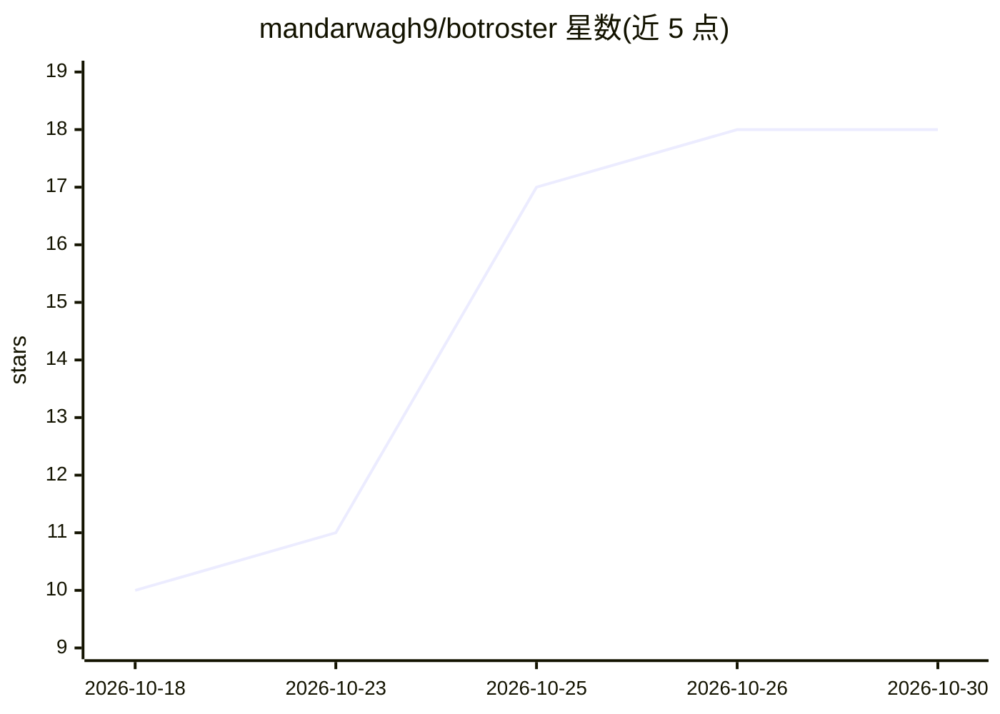

# mandarwagh9/botroster

⭐ 18 · Rust · Apache-2.0 · 推送 2026-10-02 · [GitHub](https://github.com/mandarwagh9/botroster) · 个人维护

**自托管持久 AI 队友：具名长驻 agent 共享一台可用浏览器/shell 的电脑**

Rust + Tauri 桌面应用与 CLI：用户创建具名 Bot（有固定简报、持续对话与日程），多个 Bot 共享一个持久工作区，内含 CDP 驱动的浏览器、shell 与受限于工作区根的文件系统。策略审批在控制面（hub）执行而非 agent 内，凭证由 broker 持有并在外呼时注入；支持 MCP 连接器、Agent Client Protocol、内容寻址快照与 cron/事件例程。安装包内置 OpenRouter 免费模型可零配置运行，也可接入 Ollama/LM Studio 本地模型或自定义网关。状态为 pre-alpha，guest 目前是本机普通进程而非 VM/容器。

## 筛选速览

| 维度 | 判定 | 备注 |
|---|---|---|
| AI 角色 | `ai-native` | 本体是模型或模型工具 |
| 许可风险 | `permissive` | Apache-2.0 |
| 部署形态 | `desktop` | 安装包/桌面程序 |
| 模型依赖 | local-ok | 支持本地模型 |
| 硬件要求 | — | 无带数字的原话,不猜 |
| 安装摩擦 | `low` | 无编译、无系统依赖或容器化 |
| 成熟度 | `idea` | |

## 能力要点

- 具名长驻 Bot，对话与记忆跨进程存活，可互相交接工作
- 审批与审计写在控制面而非 agent 内，agent 无法移除审批门
- 凭证 broker：Bot 自身不接触 token，连接器外呼时由 hub 注入
- 安装包内置 OpenRouter 免费模型，demo 无需 API key；自动发现本机 Ollama/LM Studio

## 适用场景

- 让 AI 队友在真实浏览器、shell 和文件系统里代为完成工作并在关键操作前请示
- 定时例程（cron/事件触发）跑 Bot 例行任务并留完整调用记录
- 通过 MCP 连接器（如 Linear）让 Bot 操作外部服务

## 场景标签

`浏览器自动化` `AI 助手` · 领域:效率与自动化

## 证据(README 行号)

> L12: Most agent tooling gives you a chat box that resets. BOTROSTER gives you **teammates**: named,
> L84: |**Bots**|Named teammates with a standing brief, a conversation that survives the process, and a schedule. Hand wor
> L88: |**Two ways in**|`botroster acp` speaks the Agent Client Protocol to any editor that does. The desktop client runs 

## 星数曲线

2026-10-18 10 → 2026-10-30 18（+8）

---
*卡片 v1 · prompt 1.4 · 生成 2026-10-29 · 置信度 high · 依据 README sha `31f32ca59f48` · [字段定义](../../DATASET.md)*
