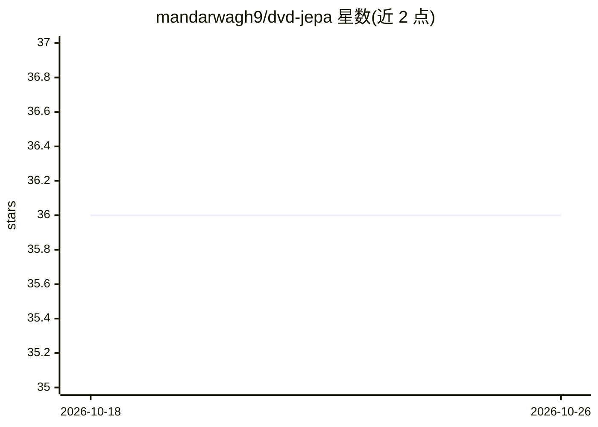

# mandarwagh9/dvd-jepa

⭐ 36 · Python · MIT · 推送 2026-06-13 · [GitHub](https://github.com/mandarwagh9/dvd-jepa) · [官网](https://dvd-jepa.vercel.app) · 个人维护

**微型可复现 JEPA 世界模型：表征空间学习弹跳 DVD 标志物理**

面向科研与教学的最小 JEPA（Joint-Embedding Predictive Architecture）实现：世界为 16×16 盒内弹跳的 DVD 标志，用上下文编码器、EMA 目标编码器与隐空间预测器做自监督训练（无标签、无解码器），在 32 维表征空间预测未来。附加可选解码器后可在隐空间前向 rollout 渲染未来视频约 20 步；预测误差可作为异常信号（注入传送后峰值达基线 88 倍）。CPU 上约 10 秒完成训练，附浏览器交互演示、Colab 笔记本与可复现的 arXiv 风格论文。限制：rollout 约 20 步后漂移、环境确定性无多模态隐变量。

## 筛选速览

| 维度 | 判定 | 备注 |
|---|---|---|
| AI 角色 | `ai-native` | 本体是模型或模型工具 |
| 许可风险 | `permissive` | MIT |
| 部署形态 | `library` | 以包/库形式分发 |
| 模型依赖 | — | README 未给出锁定关系 |
| 硬件要求 | `cpu-ok` | |
| 安装摩擦 | `low` | 无编译、无系统依赖或容器化 |
| 成熟度 | — | 结构信号不足 |

## 能力要点

- 线性探针从 32 维隐表征恢复标志位置，误差 0.73 像素
- 隐空间前向 rollout 渲染未来视频（含墙面反弹）约 20 步
- 1 步预测误差作异常信号，注入传送后峰值达基线 88 倍
- CPU 约 10 秒训练，附浏览器端（纯 JavaScript）交互演示

## 适用场景

- 以最小可复现实例理解 JEPA 架构与表征预测机制
- 观察隐空间 rollout 的预测与漂移行为
- 复现论文数字并复用异常检测（预测误差）思路

## 场景标签

`科研工具` `教程课程` · 领域:学习与行业

## 证据(README 行号)

> L20: **DVD-JEPA** is the smallest honest demonstration of that idea we could build. The "world" is a DVD logo bouncing i
> L24: 3. **It is useful.** Run it as a 1-step predictive monitor and the prediction error becomes an **anomaly signal**: 
> L79: |Anomaly peak / baseline|**88×**|a teleport is detected via prediction error…|

## 星数曲线

2026-10-18 36 → 2026-10-26 36（+0）

---
*卡片 v1 · prompt 1.4 · 生成 2026-10-25 · 置信度 high · 依据 README sha `29ac63b203ab` · [字段定义](../../DATASET.md)*
