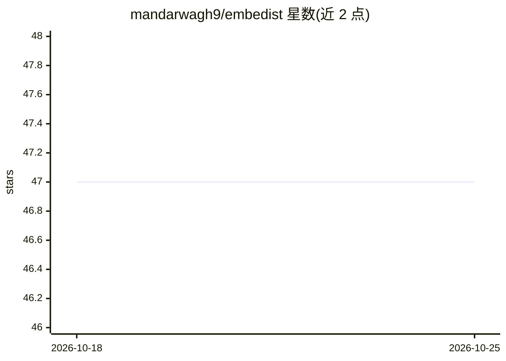

# mandarwagh9/embedist

⭐ 47 · TypeScript · MIT · 推送 2026-05-28 · [GitHub](https://github.com/mandarwagh9/embedist) · 个人维护

**Windows 桌面嵌入式开发环境，内置多模型 AI 辅助**

基于 Tauri 2 + React + TypeScript 的 Windows 桌面应用，面向 ESP32/Arduino 等嵌入式固件开发：集成 Monaco 编辑器、文件树、串口监视器与 PlatformIO CLI 构建/烧录，并提供 Chat/Plan/Agent/Debug 四种 AI 模式，支持 OpenAI、Anthropic、Google、DeepSeek、Ollama、NVIDIA NIM 与自定义 vLLM 端点，AI 调试时使用检测到的板卡信息。限制：仅 Windows 10/11 64 位；PlatformIO 与 API Key 为可选依赖；存在多项已知问题（如拖放为占位实现）。

## 筛选速览

| 维度 | 判定 | 备注 |
|---|---|---|
| AI 角色 | `ai-enhanced` | 去掉 AI 部分产品仍成立 |
| 许可风险 | `permissive` | MIT |
| 部署形态 | `desktop` | 安装包/桌面程序 |
| 模型依赖 | local-ok | 支持本地模型 |
| 硬件要求 | — | 无带数字的原话,不猜 |
| 安装摩擦 | `low` | 无编译、无系统依赖或容器化 |
| 成熟度 | — | 结构信号不足 |

## 能力要点

- Chat/Plan/Agent/Debug 四种 AI 模式，接入 7 类提供商含自定义 vLLM 端点
- 板卡感知的 AI 调试（识别 ESP32 Dev Module、Arduino Uno 等板型）
- PlatformIO CLI 构建烧录集成与实时串口监视
- Tauri 2 Rust 后端，可执行文件约 5.7 MB

## 适用场景

- 在单一桌面环境中完成嵌入式项目的编辑、构建、烧录与串口调试
- 让 AI 结合板卡信息分析固件问题与实现代码
- 通过本地 Ollama 或自定义 vLLM 端点使用 AI 功能

## 场景标签

`编码 Agent` · 领域:编码与开发

## 证据(README 行号)

> L15: Embedist is a Windows desktop application that combines AI assistance with embedded firmware development. Built wit
> L43: - 🤖 **Multi-Provider AI** — Chat, Plan, Agent, and Debug modes with support for OpenAI, Anthropic, Google, DeepSeek

## 星数曲线

2026-10-18 47 → 2026-10-25 47（+0）

---
*卡片 v1 · prompt 1.4 · 生成 2026-10-25 · 置信度 high · 依据 README sha `72c8b68a527f` · [字段定义](../../DATASET.md)*
