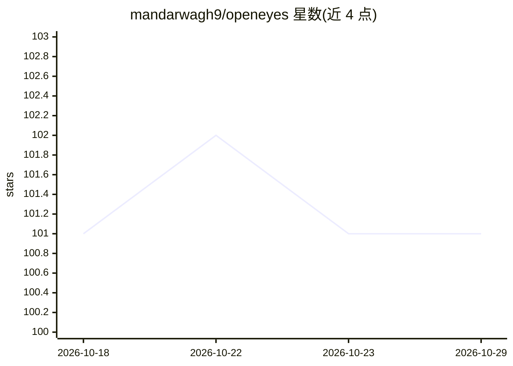

# mandarwagh9/openeyes

⭐ 101 · Python · Apache-2.0 · 推送 2026-04-17 · [GitHub](https://github.com/mandarwagh9/openeyes) · [官网](https://www.openeyes.cc/) · 个人维护

**边缘设备机器人视觉框架：实时检测/跟踪/深度/跟随**

面向 NVIDIA Jetson、树莓派 5 + AI HAT、Intel NPU、Hailo-8 等边缘平台的机器人视觉框架。流水线为 Camera→Detection→Tracking→Depth→Control，集成了 YOLOv10n 目标检测（TensorRT 优化）、MediaPipe 人脸/手势/姿态、MiDaS/Depth Anything 深度估计、ByteTrack 跟踪与自主跟人，通过 DeepStream 实现 GPU 加速（Jetson Orin Nano 上全流水线 15-35 FPS）。提供 ROS2 集成（10+ 话题）与 Docker 部署，支持 Python 从源码安装运行。

## 筛选速览

| 维度 | 判定 | 备注 |
|---|---|---|
| AI 角色 | `ai-native` | 本体是模型或模型工具 |
| 许可风险 | `permissive` | Apache-2.0 |
| 部署形态 | `self-host` | docker 或自建部署 |
| 模型依赖 | — | README 未给出锁定关系 |
| 硬件要求 | — | 无带数字的原话,不猜 |
| 安装摩擦 | `low` | 无编译、无系统依赖或容器化 |
| 成熟度 | — | 结构信号不足 |

## 能力要点

- YOLOv10n + TensorRT 目标检测与 ByteTrack 跟踪流水线
- DeepStream GPU 加速流水线（Orin Nano 上 30-40 FPS）
- 四类边缘平台支持：Jetson/树莓派 AI HAT/Intel NPU/Hailo
- ROS2 集成 10+ 话题与 Docker 部署

## 适用场景

- 边缘机器人上的实时人体检测与自主跟随
- 通过 ROS2 话题向机器人控制系统输出视觉感知结果
- 在 Jetson/树莓派等低功耗设备上部署多模型视觉流水线

## 场景标签

`目标检测` · 领域:感知与多模态

## 证据(README 行号)

> L14: OpenEyes is an open-source robot vision framework for edge devices. It runs on **NVIDIA Jetson**, **Raspberry Pi + 
> L33: |🔍 **Object Detection**|YOLOv10n with TensorRT (80+ classes)|
> L39: |🚶 **Person Following**|Autonomous person tracking|

## 星数曲线

2026-10-18 101 → 2026-10-29 101（+0）

---
*卡片 v1 · prompt 1.4 · 生成 2026-10-23 · 置信度 mid · 依据 README sha `a45c66a34e3b` · [字段定义](../../DATASET.md)*
