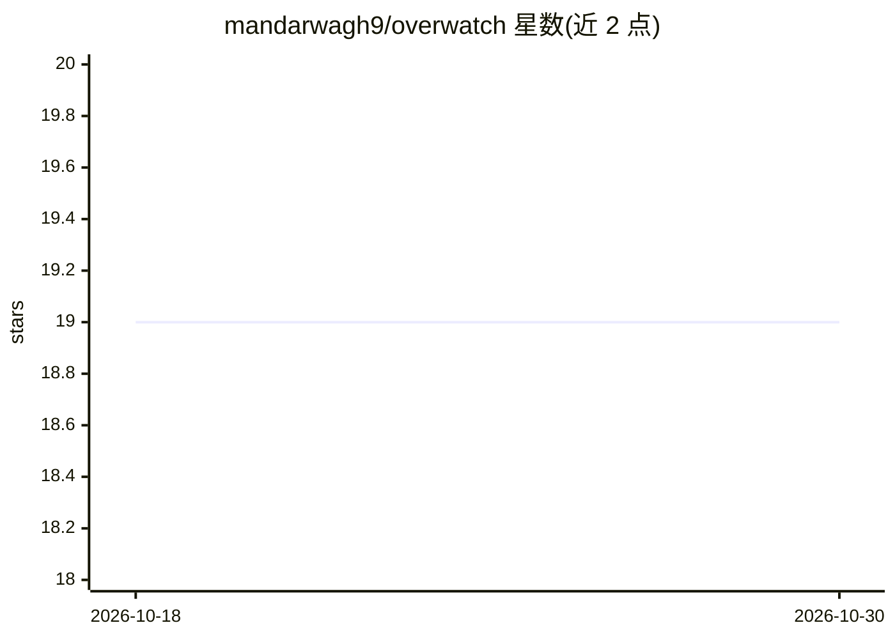

# mandarwagh9/overwatch

⭐ 19 · Python · MIT · 推送 2026-06-19 · [GitHub](https://github.com/mandarwagh9/overwatch) · 个人维护

**多摄像头边缘态势感知平台：Jetson 上融合检测跟踪**

面向 NVIDIA Jetson Orin Nano 边缘部署的实时多摄像头态势感知系统，定位为 Anduril Connected Warfare/Lattice 概念的社区参考实现（非官方、非军规）。用 YOLOv8 做仅限行人的检测（TensorRT FP16，约 8 MiB 引擎、推理低于 10 ms），匈牙利匹配跟踪、置信度自适应卡尔曼融合、跨相机 HSV 直方图重识别与单应性投影，支持 IP 摄像头与手机摄像头，经 msgpack WebSocket 广播，附 Canvas 战术 HUD。FastAPI/React 技术栈，提供自动化 Jetson 部署脚本与回滚。作者声明为研究/教育项目，未认证用于任何实际作业场景；部分能力（DeepSORT 回退链等）列为规划中。

## 筛选速览

| 维度 | 判定 | 备注 |
|---|---|---|
| AI 角色 | `ai-native` | 本体是模型或模型工具 |
| 许可风险 | `permissive` | MIT |
| 部署形态 | `library` | 以包/库形式分发 |
| 模型依赖 | — | README 未给出锁定关系 |
| 硬件要求 | — | 无带数字的原话,不猜 |
| 安装摩擦 | `medium` | 含编译或系统依赖之一 |
| 成熟度 | `idea` | |

## 能力要点

- YOLOv8 行人检测 + TensorRT FP16（约 8 MiB 引擎，推理低于 10 ms）
- 匈牙利/IoU 跟踪 + 6 状态自适应卡尔曼融合 + 跨相机 HSV 重识别
- 最多 4 路并发流（IP 摄像头 + 手机浏览器虚拟摄像头），含 GPS/IMU 融合
- paramiko 自动化 Jetson 部署：原子交换、JWT 密钥生成、--rollback 回滚

## 适用场景

- 在 Jetson 开发板上低成本复现多传感器边缘感知概念
- 研究者/学生 fork 改造学习跨相机跟踪与传感器融合原理
- 民用态势感知原型：多摄像头目标跟踪与战术 HUD 展示

## 场景标签

`目标检测` · 领域:感知与多模态

## 证据(README 行号)

> L63: OVERWATCH is a real-time multi-camera situational awareness platform built for edge deployment on NVIDIA Jetson Ori
> L105: |**Person detection**|YOLOv8n with NMS-level class filter (`classes=[0]`) — person-only|

## 星数曲线

2026-10-18 19 → 2026-10-30 19（+0）

---
*卡片 v1 · prompt 1.4 · 生成 2026-10-28 · 置信度 high · 依据 README sha `263f3fa4a80e` · [字段定义](../../DATASET.md)*
