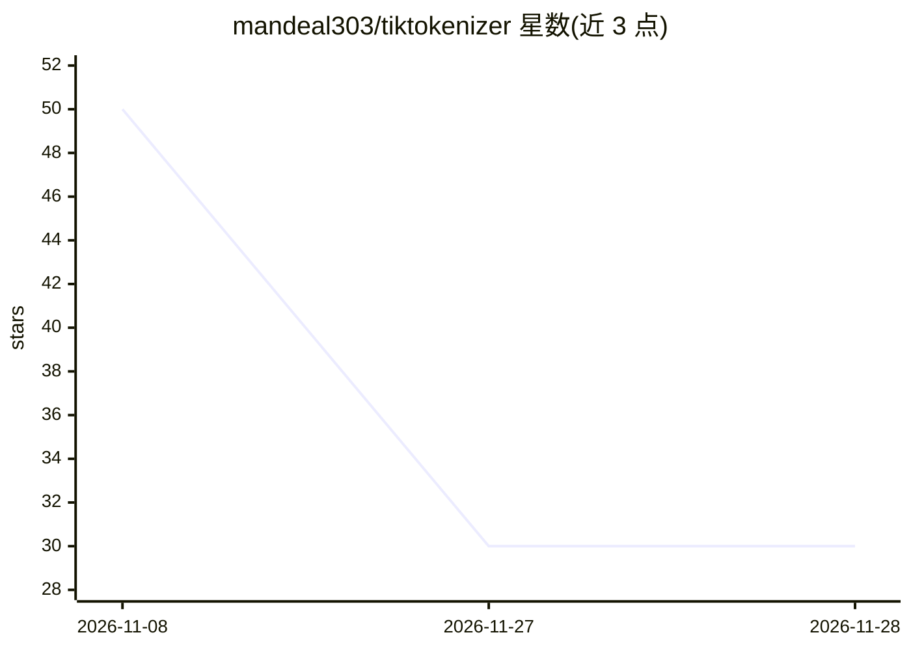

# mandeal303/tiktokenizer

⭐ 30 · TypeScript · MIT · 推送 2026-11-05 · [GitHub](https://github.com/mandeal303/tiktokenizer) · 个人维护

**在线对比不同语言模型分词效果的交互式 playground**

基于 Next.js/React 构建的网页应用，围绕 openai/tiktoken 计算 prompt 的 token 数量，供用户对比不同语言模型对同一段文本的分词结果。面向需要估算 token 消耗或理解分词行为的开发者和 LLM 使用者。README 信息有限，仅说明其为 openai/tiktoken 的在线 playground，未提供详细安装或部署说明。

## 筛选速览

| 维度 | 判定 | 备注 |
|---|---|---|
| AI 角色 | `ai-ecosystem` | LLM/agent 周边工具 |
| 许可风险 | `permissive` | MIT |
| 部署形态 | `None` |  |
| 模型依赖 | — | README 未给出锁定关系 |
| 硬件要求 | — | 无带数字的原话,不猜 |
| 安装摩擦 | `low` | 无编译、无系统依赖或容器化 |
| 成熟度 | — | 结构信号不足 |

## 能力要点

- 计算给定 prompt 的准确 token 数量
- 交互式对比不同语言模型对同一文本的分词结果

## 适用场景

- 提交前估算 prompt 的 token 消耗
- 对比不同模型的分词差异以理解模型行为

## 场景标签

`提示工程` · 领域:Agent 开发

## 证据(README 行号)

> L3: Online playground for `openai/tiktoken`, calculating the correct number of tokens for a given prompt.

## 星数曲线

2026-11-08 50 → 2026-11-28 30（-20）

---
*卡片 v1 · prompt 1.4 · 生成 2026-11-18 · 置信度 mid · 依据 README sha `f397fc0cf655` · [字段定义](../../DATASET.md)*
