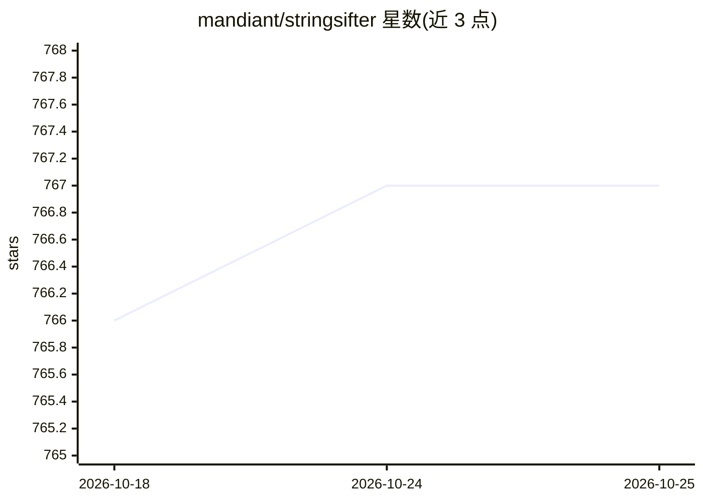

# mandiant/stringsifter

⭐ 767 · Python · Apache-2.0 · 推送 2026-07-24 · [GitHub](https://github.com/mandiant/stringsifter) · 组织维护

**按恶意软件分析相关性对字符串排序的机器学习工具**

Mandiant（FireEye）开源的排序工具：内置 flarestrings 从二进制中提取字符串（模仿 GNU binutils 的 strings），rank_strings 使用 learning-to-rank 模型按字符串与恶意软件分析的相关性打分排序，支持管道组合、批量处理、分数阈值与 Top-N 过滤。提供 pip 安装与 Docker 运行方式，要求 Python 3.9+，可应用于内存转储、沙箱运行结果或 FLOSS 输出等任意字符串列表。面向恶意软件分析/逆向工程从业者。

## 筛选速览

| 维度 | 判定 | 备注 |
|---|---|---|
| AI 角色 | `ai-native` | 本体是模型或模型工具 |
| 许可风险 | `permissive` | Apache-2.0 |
| 部署形态 | `self-host` | docker 或自建部署 |
| 模型依赖 | — | README 未给出锁定关系 |
| 硬件要求 | — | 无带数字的原话,不猜 |
| 安装摩擦 | `low` | 无编译、无系统依赖或容器化 |
| 成熟度 | — | 结构信号不足 |

## 能力要点

- learning-to-rank 模型按恶意软件分析相关性排序字符串
- flarestrings 提取字符串（模仿 GNU strings，跨平台输出一致）
- 支持 --scores/--limit/--min-score/--batch 等命令行选项
- 可应用于 FLOSS 输出、内存转储等任意字符串列表

## 适用场景

- 从恶意软件样本中快速定位高相关性字符串
- 对沙箱运行结果或内存转储提取的字符串排序
- 批量处理一个文件夹的 strings 输出

## 场景标签

`网络安全` · 领域:学习与行业

## 证据(README 行号)

> L1: StringSifter is a machine learning tool that automatically ranks strings based on their relevance for malware analys
> L41: flarestrings <my_sample> | rank_strings

## 星数曲线

2026-10-18 766 → 2026-10-25 767（+1）

---
*卡片 v1 · prompt 1.4 · 生成 2026-10-21 · 置信度 high · 依据 README sha `20898c2d364e` · [字段定义](../../DATASET.md)*
