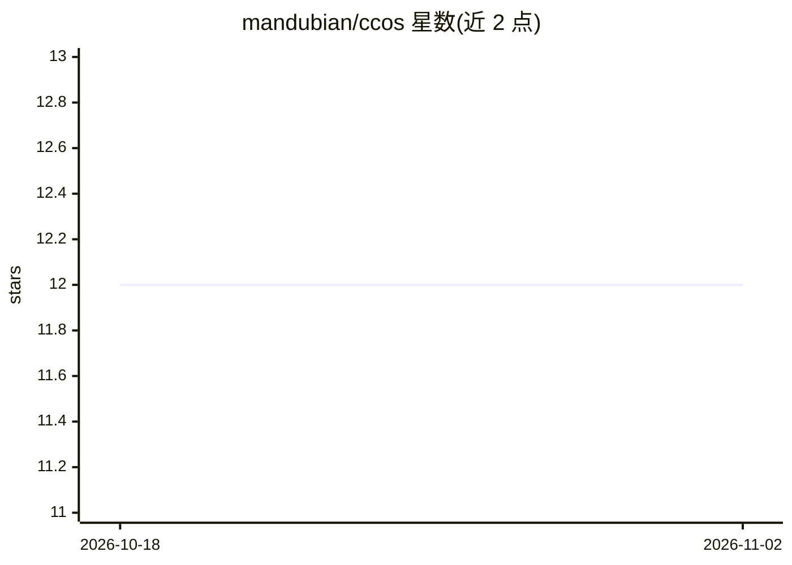

# mandubian/ccos

⭐ 12 · Rust · NOASSERTION · 推送 2026-03-22 · [GitHub](https://github.com/mandubian/ccos) · 个人维护

**面向受治理自主智能体的运行时与专用语言（Rust）**

由 mandubian 维护的 Rust 项目，包含两部分：CCOS——构建自主、自进化 agent 的框架，提供治理内核（外部动作需策略授权）、Causal Chain 审计记录、能力发现与隔离（MCP/OpenAPI 工具隔离→批准→注册）；RTFS——默认纯函数、副作用仅经 (call ...) 显式宿主边界的 Lisp 风格语言，计划可在执行前被检查/验证/改写。LLM 被用作组件（规划、能力合成、RTFS 修复），执行由 Orchestrator + RTFS 运行时驱动。README 明示多项功能仍为 Partial/Evolving。

## 筛选速览

| 维度 | 判定 | 备注 |
|---|---|---|
| AI 角色 | `ai-ecosystem` | LLM/agent 周边工具 |
| 许可风险 | `none` | NOASSERTION |
| 部署形态 | `None` |  |
| 模型依赖 | — | README 未给出锁定关系 |
| 硬件要求 | — | 无带数字的原话,不猜 |
| 安装摩擦 | `low` | 无编译、无系统依赖或容器化 |
| 成熟度 | `idea` | |

## 能力要点

- 治理内核：外部动作先经策略与审批，执行可重放
- RTFS 语言：纯核心 + (call ...) 显式宿主边界，计划即数据
- MCP/OpenAPI 工具发现与隔离接入（隔离→批准→注册），密钥不暴露给 agent
- 提供 ccos-mcp 服务器，任意 MCP 客户端（Cursor/Claude 等）可接入

## 适用场景

- 构建需要审批与审计的多步自主 agent
- 通过 MCP 从 Cursor/Claude 等 agent 客户端调用 CCOS 能力
- 以可检查、可验证的计划表示代替 JSON/Python 编排 agent 行为

## 场景标签

`Agent 框架` · 领域:Agent 开发

## 证据(README 行号)

> L9: **CCOS** is a framework for building **autonomous and self-evolving agents** safely:
> L145: The LLM is a **component**, not the system. CCOS uses LLMs primarily in the **Cognitive Engine** (planning, discov
> L175: Yes. Run `ccos-mcp` and connect as an MCP client:

## 星数曲线

2026-10-18 12 → 2026-11-02 12（+0）

---
*卡片 v1 · prompt 1.4 · 生成 2026-11-01 · 置信度 high · 依据 README sha `a8d0a49157cb` · [字段定义](../../DATASET.md)*
