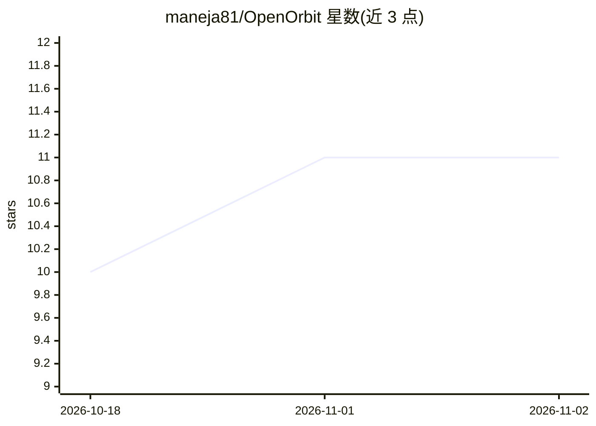

# maneja81/OpenOrbit

⭐ 11 · TypeScript · MIT · 推送 2026-11-01 · [GitHub](https://github.com/maneja81/OpenOrbit) · 个人维护

**本地优先的桌面 AI 多智能体编排应用**

基于 Electron + React 的桌面应用：一个中央编排器（默认名 Orbit）将消息路由给多个专职子智能体，内置 Cipher/Atlas/Explorer/Chrono 四个，可通过对话新建智能体。智能体可访问授权的本地文件夹、网络搜索、知识库（支持 PDF/Office/代码等多种格式）、Google OAuth 连接器、MCP 服务器与自定义 HTTP 工具。数据存储在本地 SQLite，支持任意 OpenAI 兼容 API（含 OpenRouter、Ollama）。作者声明为业余个人项目，无支持与路线图承诺。

## 筛选速览

| 维度 | 判定 | 备注 |
|---|---|---|
| AI 角色 | `ai-native` | 本体是模型或模型工具 |
| 许可风险 | `permissive` | MIT |
| 部署形态 | `desktop` | 安装包/桌面程序 |
| 模型依赖 | local-ok | 支持本地模型 |
| 硬件要求 | — | 无带数字的原话,不猜 |
| 安装摩擦 | `low` | 无编译、无系统依赖或容器化 |
| 成熟度 | `idea` | |

## 能力要点

- 中央编排器 + 可自定义子智能体的多智能体架构
- 接入 MCP 服务器、Google 连接器与自定义 HTTP 工具
- 数据全程本地 SQLite 存储，凭据 AES-256-GCM 加密
- 任意 OpenAI 兼容 API，支持 OpenRouter 与 Ollama 换 baseURL 接入

## 适用场景

- 在桌面用一组各司其职的 AI 智能体处理文件、搜索与日程任务
- 自建领域专属智能体并挂接 MCP 工具
- 数据不出本机地使用多智能体工作流

## 场景标签

`多智能体` `AI 助手` · 领域:Agent 开发

## 证据(README 行号)

> L7: A desktop app that runs a team of AI agents on your own machine — a central orchestrator
> L38: Instead of one chatbot, you get a roster of agents visualized as nodes orbiting a central

## 星数曲线

2026-10-18 10 → 2026-11-02 11（+1）

---
*卡片 v1 · prompt 1.4 · 生成 2026-11-02 · 置信度 high · 依据 README sha `965d2f6fccf5` · [字段定义](../../DATASET.md)*
