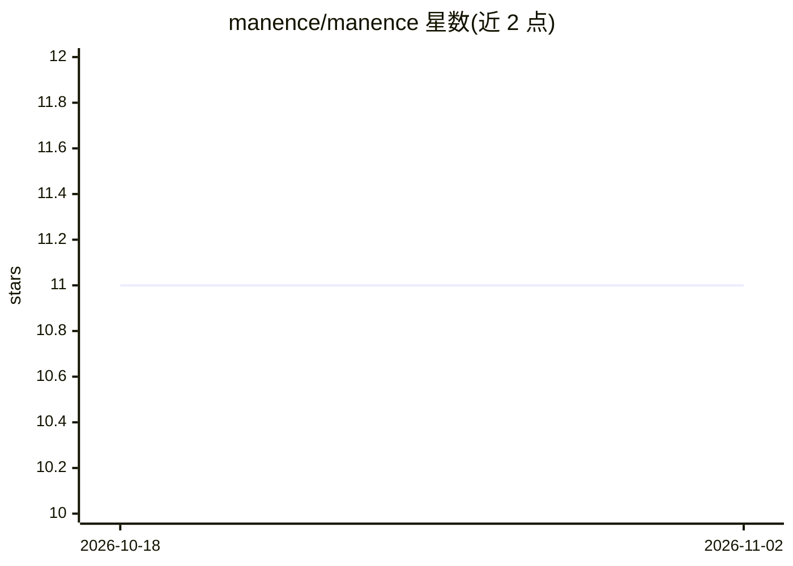

# manence/manence

⭐ 11 · Shell · NOASSERTION · 推送 2026-10-24 · [GitHub](https://github.com/manence/manence) · [官网](https://manence.ai) · 个人维护 · 中文 README

**让 AI 在长期项目中可靠运行的 Markdown+git 工作系统**

一套以 Markdown 与 git 为载体、面向 AI agent（聊天或代理模式）的工作系统（Manence OS）：以知识库保存已验证事实，以 workstream 组织进行中的工作并接入 CRM/分析/仓库等真实工具，规则是每次交互既完成工作又更新系统。安装后由 agent 执行首次设置访谈；代码与模板为 MIT，学说文档为 CC BY-NC-SA，README 声明双许可见 LICENSE.md。模型可替换，支持 Claude Code、Grok Build、OpenAI Codex 等驱动。

## 筛选速览

| 维度 | 判定 | 备注 |
|---|---|---|
| AI 角色 | `ai-ecosystem` | LLM/agent 周边工具 |
| 许可风险 | `none` | NOASSERTION |
| 部署形态 | `None` |  |
| 模型依赖 | — | README 未给出锁定关系 |
| 硬件要求 | — | 无带数字的原话,不猜 |
| 安装摩擦 | `low` | 无编译、无系统依赖或容器化 |
| 成熟度 | — | 结构信号不足 |

## 能力要点

- 知识库/workstream/日志三器官结构，每次交换同时更新系统
- 一条 curl 命令安装，随后由 agent 执行 'run my first setup' 引导式初始化
- 数据为纯 Markdown+git，AI 模型为可替换组件，AGENTS.md 跨工具标准
- Manence UI 为独立读取器，MOS 本身不依赖它

## 适用场景

- 长期项目里让 AI 始终从已验证的知识出发工作
- 记录决策及其理由，供日后追问与追溯
- 让 agent 接入 CRM、分析等真实工具并在其数据上工作

## 场景标签

`知识库管理` `Agent 记忆` · 领域:Agent 开发

## 证据(README 行号)

> L5: **Manence makes your AI reliable on long-running projects.** An AI, whether in chat or agentic mode, knows only its 
> L19: Manence is a work system where **working already produces order**. It rests on three organs:

## 星数曲线

2026-10-18 11 → 2026-11-02 11（+0）

---
*卡片 v1 · prompt 1.4 · 生成 2026-11-02 · 置信度 high · 依据 README sha `cbcd8eeb2b64` · [字段定义](../../DATASET.md)*
