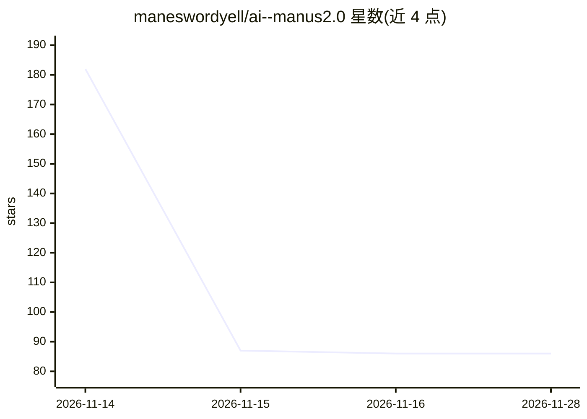

# maneswordyell/ai--manus2.0

⭐ 86 · Apache-2.0 · 推送 2026-11-15 · [GitHub](https://github.com/maneswordyell/ai--manus2.0) · 个人维护

**面向日常小任务的自主 AI Agent：代跑代码与控制浏览器**

自述为自主运行的 AI Agent，核心能力是代替用户执行代码脚本与控制浏览器：可编写并运行脚本、打开网页、填写表单、交互页面元素，并执行多步骤任务，无需持续监督；脚本与浏览器操作可在同一任务流中衔接。README 面向家庭、学习与轻量办公场景的用户，无需编程背景。文中列出系统兼容性表（最低 4GB 内存、双核 CPU）与六步上手流程，但未给出任何实际的安装命令、下载链接（仅'Download Manus'与优惠码字样）或源码说明，仓库内容的可验证信息有限。

## 筛选速览

| 维度 | 判定 | 备注 |
|---|---|---|
| AI 角色 | `ai-native` | 本体是模型或模型工具 |
| 许可风险 | `permissive` | Apache-2.0 |
| 部署形态 | `None` |  |
| 模型依赖 | — | README 未给出锁定关系 |
| 硬件要求 | — | 无带数字的原话,不猜 |
| 安装摩擦 | `low` | 无编译、无系统依赖或容器化 |
| 成熟度 | — | 结构信号不足 |

## 能力要点

- 自主编写并执行代码完成多步任务
- 浏览器控制：导航网页、填写表单、抓取信息
- 脚本与浏览器动作可在同一任务流中衔接

## 适用场景

- 让 Agent 代为完成查网页、填表等重复性操作
- 整理研究资料、运行小脚本等学习任务
- 轻量办公中跨多页面收集信息并汇总

## 场景标签

`浏览器自动化` `AI 助手` · 领域:效率与自动化

## 证据(README 行号)

> L10: - **Autonomous Code Execution:** Manus AI agent runs code on its own to complete tasks, so you can focus on decisio
> L18: Manus is an autonomous AI agent designed to run code and control a browser on your behalf. Instead of acting like a

## 星数曲线

2026-11-14 182 → 2026-11-28 86（-96）

---
*卡片 v1 · prompt 1.4 · 生成 2026-11-17 · 置信度 mid · 依据 README sha `637da4fbcded` · [字段定义](../../DATASET.md)*
