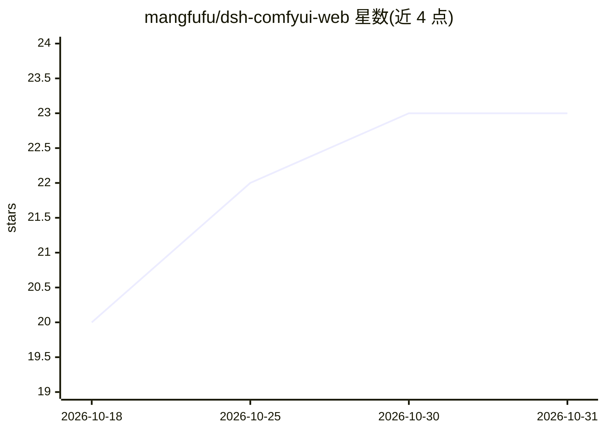

# mangfufu/dsh-comfyui-web

⭐ 23 · JavaScript · 推送 2026-10-24 · [GitHub](https://github.com/mangfufu/dsh-comfyui-web) · 个人维护 · 中文 README

**在 dsh 网页内嵌 ComfyUI 并让 AI 经 MCP 操作工作流的插件**

面向已使用 dsh 与本机 ComfyUI 的用户：插件把 ComfyUI 编辑器嵌入 dsh 右侧面板，左侧对话中由 AI 通过 MCP 读取并修改当前工作流（改提示词、调参数、提交生图），节点变化与生成预览同页可见。支持从 dsh 启动本机 ComfyUI（exe/bat/ps1/快捷方式等多种入口）、Docker/WSL 挂载 custom_nodes、撤销快照（最多 20 份）、任务排队与完成通知。限制：需 Node.js 22+、pnpm，插件版本与 dsh 版本有对应表，其他版本需另行验证。

## 筛选速览

| 维度 | 判定 | 备注 |
|---|---|---|
| AI 角色 | `ai-native` | 本体是模型或模型工具 |
| 许可风险 | `none` | — |
| 部署形态 | `desktop` | 安装包/桌面程序 |
| 模型依赖 | — | README 未给出锁定关系 |
| 硬件要求 | — | 无带数字的原话,不猜 |
| 安装摩擦 | `low` | 无编译、无系统依赖或容器化 |
| 成熟度 | — | 结构信号不足 |

## 能力要点

- AI 经 MCP 读取/修改当前工作流并提交生图，修改实时可见
- 从 dsh 启动本机 ComfyUI（支持 exe/bat/cmd/ps1/lnk、AKi/便携包/venv）
- Docker/WSL 持久化挂载 custom_nodes 的桥接扩展配置
- 撤销/重做/修改快照（最多 20 份）与生成任务跟踪、完成通知

## 适用场景

- 在对话里让 AI 优化提示词并直接生图，右侧看预览
- 在 dsh 内一站式管理并启动本机 ComfyUI
- 用自然语言切换/复制工作流标签页、管理生成任务

## 场景标签

`图像生成` · 领域:内容生成

## 证据(README 行号)

> L5: 在 dsh 里直接使用 ComfyUI，让 AI 通过 MCP 操作当前工作流。改提示词、调参数、运行生图，节点变化和生成预览都在同一个页面里看得见。
> L104: > 读取当前工作流，优化正向提示词，保留现有模型和节点连接，生成一张图并查看效果。
> L106: AI 修改提示词并生成图片

## 星数曲线

2026-10-18 20 → 2026-10-31 23（+3）

---
*卡片 v1 · prompt 1.4 · 生成 2026-10-27 · 置信度 high · 依据 README sha `86fc0e107b4c` · [字段定义](../../DATASET.md)*
