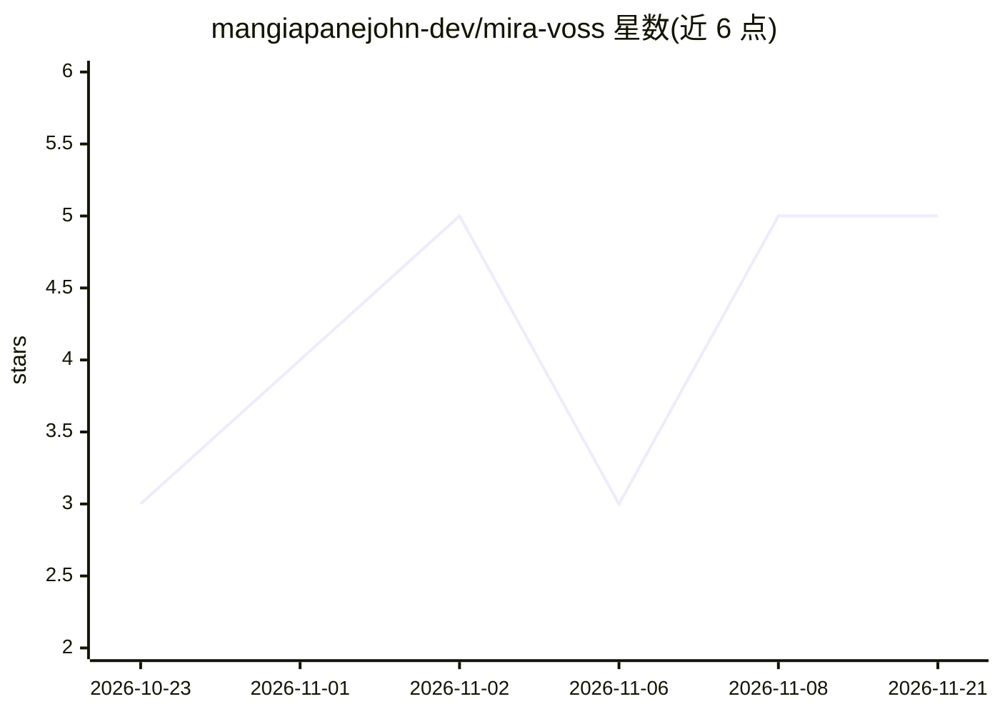

# mangiapanejohn-dev/mira-voss

⭐ 5 · HTML · 推送 2026-10-30 · [GitHub](https://github.com/mangiapanejohn-dev/mira-voss) · [官网](https://mangiapanejohn-dev.github.io/mira-voss/) · 个人维护 · 中文 README

**终端 AI 编码 agent（npm CLI），附带角色小说世界观**

以 npm 包分发的终端 agent：读取项目、编辑文件、运行命令并在改动前请求确认，提供 default/accept-edits/full/plan 四种权限模式、/model 多账号切换、@文件引用、/rewind 回退、-p 单轮脚本模式（text/json/stream-json 输出）。登录方式包括 Claude/ChatGPT 订阅计划或多家 API key，密钥存于 ~/.mobius。要求 Node.js 22+。agent 本体闭源经 npm 分发，本仓库不含其代码，另收录中英双语小说、角色设定与网站。

## 筛选速览

| 维度 | 判定 | 备注 |
|---|---|---|
| AI 角色 | `ai-native` | 本体是模型或模型工具 |
| 许可风险 | `none` | — |
| 部署形态 | `library` | 以包/库形式分发 |
| 模型依赖 | — | README 未给出锁定关系 |
| 硬件要求 | — | 无带数字的原话,不猜 |
| 安装摩擦 | `low` | 无编译、无系统依赖或容器化 |
| 成熟度 | — | 结构信号不足 |

## 能力要点

- 四种权限模式与逐改动确认卡片（ctrl+y/ctrl+n）
- 支持订阅计划（Claude/ChatGPT）与 10+ 家 API key 多账号共存切换
- -p 单轮模式支持脚本与管道，输出 text/json/stream-json
- MØBIUS 内核为 OpenAI Codex 的 fork（Apache-2.0），运行于 Bun

## 适用场景

- 在终端里让 agent 读写项目文件并执行命令
- 用 -p 模式把单轮任务接进脚本和 CI 管道
- 阅读以该角色为主角的配套小说与世界观资料

## 场景标签

`编码 Agent` · 领域:编码与开发

## 证据(README 行号)

> L13:  An agent at your terminal. She reads your project, edits files, runs commands and reports back, in the folder you 
> L19:  Mira Voss 1.0.0 in a terminal on first launch: a sign-in list of plans (Claude, ChatGPT) and API keys (Anthropic, 
> L43: - **A model to work through**: a Claude or ChatGPT plan you already pay for, or an API key. See Sign in.

## 星数曲线

2026-10-23 3 → 2026-11-21 5（+2）

---
*卡片 v1 · prompt 1.4 · 生成 2026-11-21 · 置信度 high · 依据 README sha `69065f8dd923` · [字段定义](../../DATASET.md)*
