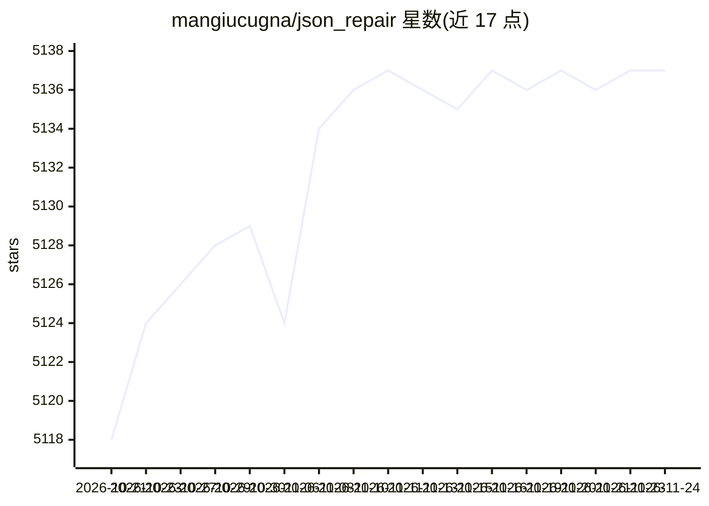

# mangiucugna/json_repair

⭐ 5,137 · Python · MIT · 推送 2026-11-22 · [GitHub](https://github.com/mangiucugna/json_repair) · [官网](https://mangiucugna.github.io/json_repair/) · 个人维护

**修复 LLM 与日志中畸形 JSON 的 Python 库**

一个 Python 库，用于修复来自 LLM 输出、API 响应、日志和用户输入中的畸形 JSON：处理缺失引号/逗号/括号、注释、杂质文本和截断值，可作为 json.loads() 的直接替换或 schema 引导的修复步骤。默认先用标准库校验，失败才走修复解析器；支持严格模式、流式稳定输出、CLI 工具与 Pydantic v2 / JSON Schema 引导修复（beta，需额外依赖）。作者以业余项目形式维护。

## 筛选速览

| 维度 | 判定 | 备注 |
|---|---|---|
| AI 角色 | `ai-ecosystem` | LLM/agent 周边工具 |
| 许可风险 | `permissive` | MIT |
| 部署形态 | `library` | 以包/库形式分发 |
| 模型依赖 | — | README 未给出锁定关系 |
| 硬件要求 | — | 无带数字的原话,不猜 |
| 安装摩擦 | `low` | 无编译、无系统依赖或容器化 |
| 成熟度 | — | 结构信号不足 |

## 能力要点

- 可作为 json.loads()/load() 的直接替换
- JSON Schema 或 Pydantic v2 模型引导的修复（beta）
- stream_stable 支持流式输入的稳定修复
- 提供 CLI（含 --strict 模式）与在线 demo

## 适用场景

- 解析 LLM 返回的不完整或带杂质文本的 JSON
- 日志和用户输入中畸形 JSON 的清洗
- 需要按 schema 补全字段并产出确定性的结构化输出

## 场景标签

 · 领域:开发工具/数据解析

## 证据(README 行号)

> L12: Repair malformed JSON from LLMs, APIs, logs, and user input in Python.
> L47: Some LLMs are a bit iffy when it comes to returning well formed JSON data, sometimes they skip a parentheses and so

## 星数曲线

2026-10-21 5,118 → 2026-11-24 5,137（+19）

---
*卡片 v1 · prompt 1.4 · 生成 2026-11-22 · 置信度 high · 依据 README sha `836b84483673` · [字段定义](../../DATASET.md)*
