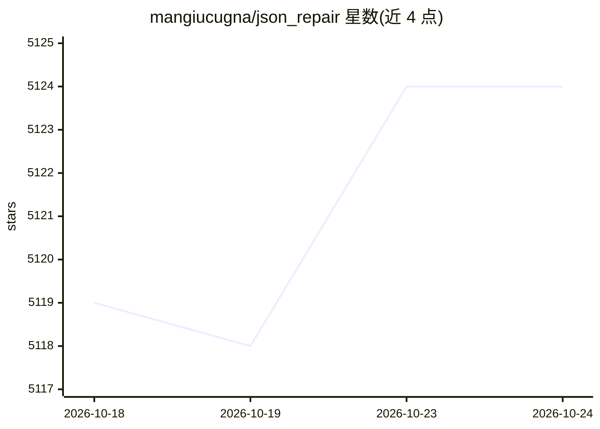

# mangiucugna/json_repair

⭐ 5,124 · Python · MIT · 推送 2026-10-23 · [GitHub](https://github.com/mangiucugna/json_repair) · [官网](https://mangiucugna.github.io/json_repair/) · 个人维护 · 中文 README

**修复 LLM/API/日志中畸形 JSON 的 Python 库**

Python 解析库：修复缺失引号、逗号、括号、注释、混杂文本与截断的 JSON 输入，面向 LLM 输出、API 返回、日志与用户输入场景。提供 loads/load/from_file 作为标准库 json 的替代接口，默认先尝试严格解析、失败后再进入修复解析器。支持 JSON Schema 或 Pydantic v2 模型引导修复（beta）、流式输入 stream_stable、strict 校验模式与 CLI（pipx 安装）。限制：schema 引导修复处于 beta；不自动使用第三方 JSON 库（如 orjson）。

## 筛选速览

| 维度 | 判定 | 备注 |
|---|---|---|
| AI 角色 | `ai-ecosystem` | LLM/agent 周边工具 |
| 许可风险 | `permissive` | MIT |
| 部署形态 | `library` | 以包/库形式分发 |
| 模型依赖 | — | README 未给出锁定关系 |
| 硬件要求 | — | 无带数字的原话,不猜 |
| 安装摩擦 | `low` | 无编译、无系统依赖或容器化 |
| 成熟度 | — | 结构信号不足 |

## 能力要点

- 修复缺引号/逗号/括号/注释/截断等畸形 JSON，可替换 json.loads
- JSON Schema 或 Pydantic v2 模型引导修复（beta，含 salvage 模式）
- 流式输入修复（stream_stable）与 strict 校验模式
- 提供 CLI 与 FastAPI/LLM 输出处理等集成示例

## 适用场景

- 解析 LLM 返回的不合规 JSON 输出
- 清洗 API 返回与日志中的畸形 JSON
- 流式传输中稳定解析部分 JSON
- 按 schema 规范化输出以满足下游校验与存储

## 场景标签

 · 领域:数据处理/LLM 输出后处理

## 证据(README 行号)

> L12: Repair malformed JSON from LLMs, APIs, logs, and user input in Python.
> L47: Some LLMs are a bit iffy when it comes to returning well formed JSON data, sometimes they skip a parentheses and so

## 星数曲线

2026-10-18 5,119 → 2026-10-24 5,124（+5）

---
*卡片 v1 · prompt 1.4 · 生成 2026-10-20 · 置信度 high · 依据 README sha `73732f2178ac` · [字段定义](../../DATASET.md)*
