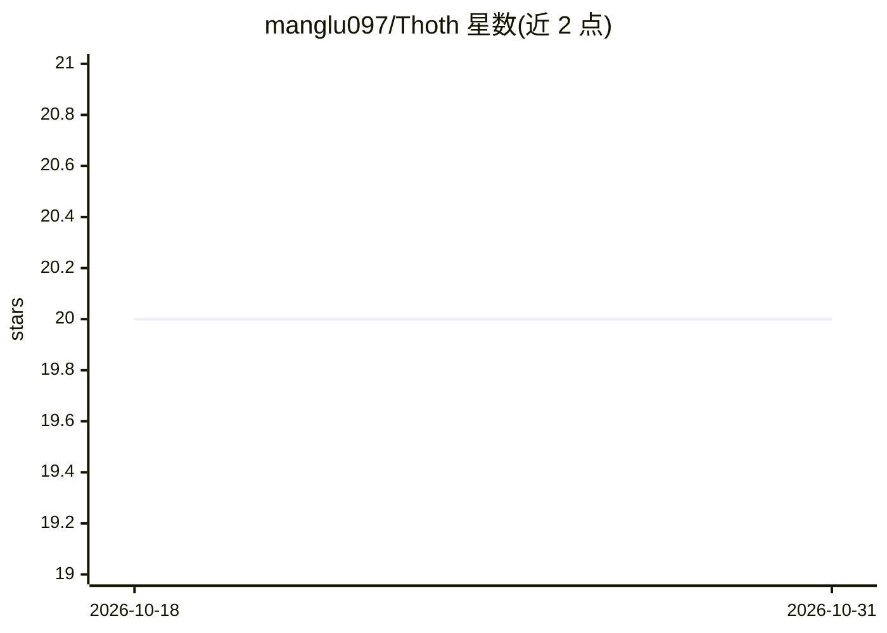

# manglu097/Thoth

⭐ 20 · Python · MIT · 推送 2026-01-30 · [GitHub](https://github.com/manglu097/Thoth) · 组织维护

**生成生物实验protocol的模型与数据集（ICLR 2026）**

面向湿实验protocol自动生成的研究项目，包含：SciRecipe数据集（12K+专家整理protocol、27个子领域）、Thoth与Thoth-mini两个基于Qwen3的模型（8B/4B，推理需17GB/8GB GPU显存）、Sketch-and-Fill三阶段推理范式，以及SCORE结构化组件奖励机制（格式门控、一致性门控、步骤规模与语义奖励）。提供HuggingFace数据集下载、推理脚本、基于VERL的训练配置与评测套件，论文标注ICLR 2026、arXiv 2510.15600，MIT许可。

## 筛选速览

| 维度 | 判定 | 备注 |
|---|---|---|
| AI 角色 | `ai-native` | 本体是模型或模型工具 |
| 许可风险 | `permissive` | MIT |
| 部署形态 | `None` |  |
| 模型依赖 | — | README 未给出锁定关系 |
| 硬件要求 | — | 无带数字的原话,不猜 |
| 安装摩擦 | `medium` | 含编译或系统依赖之一 |
| 成熟度 | — | 结构信号不足 |

## 能力要点

- SciRecipe数据集：12K+专家整理protocol覆盖27个子领域
- Sketch-and-Fill三阶段推理（分析/结构化/执行分离）
- SCORE结构化组件奖励（格式/一致性/步骤规模/语义四维）
- Thoth-8B与Thoth-mini-4B模型发布于HuggingFace

## 适用场景

- 自动生成可执行的生物实验protocol
- 用SciRecipe数据集训练和评测LLM的protocol理解与生成
- 在生物医学基准（PubMedQA、LAB-Bench等）上评测科学推理模型

## 场景标签

`模型评测` · 领域:评测与运维

## 证据(README 行号)

> L23: **Thoth** is a knowledge-to-action model that transforms scientific knowledge into accurate, logically ordered, and
> L25: - **SciRecipe**: A comprehensive dataset of 12K+ expert-curated biological protocols across 27 subfields

## 星数曲线

2026-10-18 20 → 2026-10-31 20（+0）

---
*卡片 v1 · prompt 1.4 · 生成 2026-10-28 · 置信度 high · 依据 README sha `d0b897267548` · [字段定义](../../DATASET.md)*
