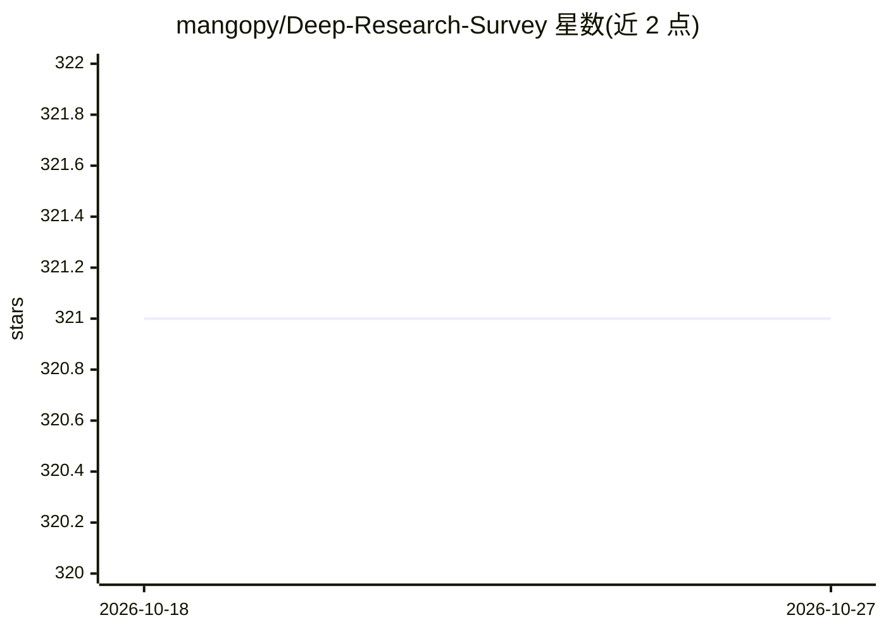

# mangopy/Deep-Research-Survey

⭐ 321 · 推送 2026-01-01 · [GitHub](https://github.com/mangopy/Deep-Research-Survey) · [官网](https://deep-research-survey.github.io/) · 个人维护

**Deep Research 方向的系统性综述与论文阅读清单**

mangopy/Deep-Research-Survey 是一篇 Deep Research（深度研究系统）系统性综述的配套仓库，于 2025-11-25 发布综述并承诺持续更新。仓库按 DR 的四个关键组件（查询规划、信息获取、记忆管理等）、常用训练范式以及基准与资源组织论文清单；每条条目含会议、日期、论文标题与 arXiv/ACL Anthology 等链接，覆盖 RAG、LLM Agent、检索增强推理等方向。面向科研人员与该方向入门读者，仓库本身不含可运行代码。

## 筛选速览

| 维度 | 判定 | 备注 |
|---|---|---|
| AI 角色 | `ai-knowledge` | 知识聚合/清单类 |
| 许可风险 | `none` | — |
| 部署形态 | `None` |  |
| 模型依赖 | — | README 未给出锁定关系 |
| 硬件要求 | — | 无带数字的原话,不猜 |
| 安装摩擦 | `low` | 无编译、无系统依赖或容器化 |
| 成熟度 | — | 结构信号不足 |

## 能力要点

- 按 DR 关键组件与训练范式分类组织论文
- 条目含会议、日期、标题与原文链接
- 承诺随领域进展持续更新阅读清单

## 适用场景

- 系统性地了解 Deep Research 领域的论文脉络
- 按查询规划、信息获取、信息过滤等主题查找代表性论文
- 跟进 RAG 与 LLM Agent 检索增强方向的最新进展

## 场景标签

`精选清单` · 领域:学习与行业

## 证据(README 行号)

> L16: This repository contains a systematic collection of research papers on Deep Research (DR). We organize papers acros
> L21: Our survey collection presents a comprehensive and systematic overview of deep research systems, including a clear 

## 星数曲线

2026-10-18 321 → 2026-10-27 321（+0）

---
*卡片 v1 · prompt 1.4 · 生成 2026-10-21 · 置信度 high · 依据 README sha `a5362550f426` · [字段定义](../../DATASET.md)*
