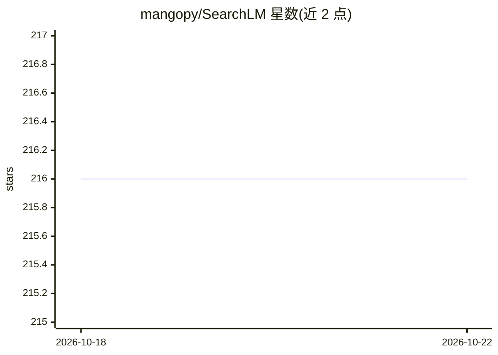

# mangopy/SearchLM

⭐ 216 · Python · Apache-2.0 · 推送 2026-01-14 · [GitHub](https://github.com/mangopy/SearchLM) · [官网](https://arxiv.org/abs/2505.20128) · 组织维护

**NeurIPS 2025 论文官方代码：EM 迭代训练 LLM 搜索代理**

NeurIPS 2025 论文《Iterative Self-Incentivization Empowers Large Language Models as Agentic Searchers》的官方代码库。提供使 LLM 作为搜索代理的训练与评测流程：先以合成数据做热启动 SFT，再交替执行 E 步（轨迹探索与熵计算）和 M 步（重加权轨迹学习）。检索侧使用 Wikipedia 语料与 ColBERT 检索 top-20 文档，检索代码取自 ColBERT。依赖 CUDA 多卡环境（示例使用 7-8 卡 torchrun），面向复现实验与训练自有搜索 LLM 的研究者。

## 筛选速览

| 维度 | 判定 | 备注 |
|---|---|---|
| AI 角色 | `ai-native` | 本体是模型或模型工具 |
| 许可风险 | `permissive` | Apache-2.0 |
| 部署形态 | `library` | 以包/库形式分发 |
| 模型依赖 | local-ok | 支持本地模型 |
| 硬件要求 | — | 无带数字的原话,不猜 |
| 安装摩擦 | `medium` | 含编译或系统依赖之一 |
| 成熟度 | — | 结构信号不足 |

## 能力要点

- 热启动 SFT + E/M 交替迭代的训练流程脚本
- E 步轨迹探索与熵计算、M 步重加权轨迹学习
- 基于 ColBERT 与 Wikipedia 语料的检索模块
- 发布带标注的冷启动数据集

## 适用场景

- 复现论文的 agentic search 训练与评测实验
- 在自己的数据上训练具备迭代检索能力的 LLM
- 基于代码扩展新的搜索代理训练方法

## 场景标签

`RAG` `微调` · 领域:知识与检索

## 证据(README 行号)

> L12: This work proposes the `ExSearch` which enable the LLMs as search agents, which can actively seek information, sele
> L53: PROCEDURE=sft CUDA_VISIBLE_DEVICES=0,1,2,3,4,5,6,7 nohup torchrun   --nproc_per_node=8 --master_port=11021 ./src/ru
> L104: @article{shi2025iterative,

## 星数曲线

2026-10-18 216 → 2026-10-22 216（+0）

---
*卡片 v1 · prompt 1.4 · 生成 2026-10-22 · 置信度 high · 依据 README sha `579e76aa2699` · [字段定义](../../DATASET.md)*
