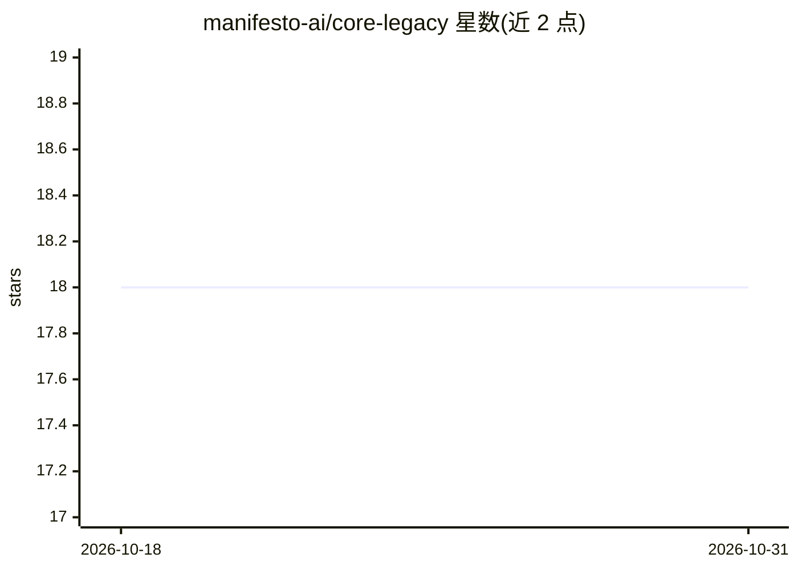

# manifesto-ai/core-legacy

⭐ 18 · TypeScript · MIT · 推送 2026-01-05 · [GitHub](https://github.com/manifesto-ai/core-legacy) · [官网](https://manifesto-ai.dev) · 组织维护

**让 AI agent 安全操作应用的语义状态层框架**

Manifesto 是一个语义操作层 TypeScript 框架：应用以声明式方式定义领域模型（数据 schema、派生值、带前置条件的动作），UI、AI agent 与 API 均作为同一语义模型的投影。通过 SemanticPath 寻址、表达式 DSL 描述业务规则，使 agent 无需从像素推断语义即可读写应用状态。以 npm 包 @manifesto-ai/core 发布（MIT），配套 React/Zustand 桥接包与 agent 集成包；规格处于 Working Draft 状态。

## 筛选速览

| 维度 | 判定 | 备注 |
|---|---|---|
| AI 角色 | `ai-ecosystem` | LLM/agent 周边工具 |
| 许可风险 | `permissive` | MIT |
| 部署形态 | `library` | 以包/库形式分发 |
| 模型依赖 | — | README 未给出锁定关系 |
| 硬件要求 | — | 无带数字的原话,不猜 |
| 安装摩擦 | `low` | 无编译、无系统依赖或容器化 |
| 成熟度 | `idea` | |

## 能力要点

- SemanticPath 为每块语义提供可寻址路径
- 规则以声明式表达式 DSL 定义，可序列化与解释
- 动作带显式前置条件与描述的效果
- 提供 React/Zustand 桥接与 AI agent 集成包

## 适用场景

- 让 AI agent 基于显式语义操作我的应用而非视觉推断
- 以单一领域模型统一 UI、API 与 agent 的状态来源
- 构建行为可解释、可分析的业务规则层

## 场景标签

`Agent 框架` · 领域:Agent 开发

## 证据(README 行号)

> L22: Manifesto is a **semantic operating layer** that turns any application into a fully observable, deterministic, and 
> L37: - 🤖 AI agents cannot safely operate (they must *infer* meaning from pixels)
> L42: **Manifesto inverts this paradigm.** Instead of AI agents *inferring* what your application means, your application

## 星数曲线

2026-10-18 18 → 2026-10-31 18（+0）

---
*卡片 v1 · prompt 1.4 · 生成 2026-10-29 · 置信度 high · 依据 README sha `8e442eef3011` · [字段定义](../../DATASET.md)*
