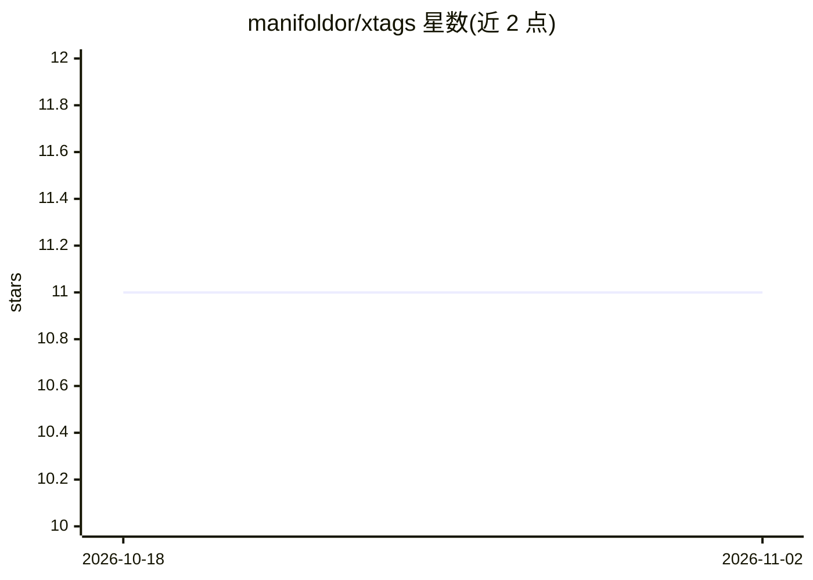

# manifoldor/xtags

⭐ 11 · HTML · MIT · 推送 2026-10-16 · [GitHub](https://github.com/manifoldor/xtags) · 个人维护 · 中文 README

**给 X 时间线帖子标注意图与疑似 AI 概率并自动折叠的 Chrome 扩展**

运行在浏览器中的 MV3 Chrome 扩展，读取用户正在浏览的 X 页面 DOM，为每条帖子请求判断四个维度（六类意图、诱导愤怒、疑似 AI 撰写、未披露推广），在原标签后显示提示与模型分数；疑似 AI 概率达到可调阈值（默认 0.85）时自动折叠正文、媒体与互动区，可手动展开。判断由外部 API 完成，默认使用 TypeSafe 的 Jev，支持兼容的自定义 HTTPS API，需要自备 API key，正文与作者账号会上传到所选服务，非设备端分析。需要 Chrome 140+，通过加载已解压目录方式安装，商店版尚未发布。

## 筛选速览

| 维度 | 判定 | 备注 |
|---|---|---|
| AI 角色 | `ai-native` | 本体是模型或模型工具 |
| 许可风险 | `permissive` | MIT |
| 部署形态 | `None` |  |
| 模型依赖 | — | README 未给出锁定关系 |
| 硬件要求 | — | 无带数字的原话,不猜 |
| 安装摩擦 | `low` | 无编译、无系统依赖或容器化 |
| 成熟度 | — | 结构信号不足 |

## 能力要点

- 一次请求判断四维度：意图/诱导愤怒/疑似AI/未披露推广
- 达到阈值自动折叠帖子，支持自动折叠/仅提示/仅标签三种模式
- 按 status ID 与正文指纹缓存去重，改阈值不重新请求
- 中英文界面，随系统语言自动切换

## 适用场景

- 浏览 X 时自动折叠疑似 AI 生成的帖子，减少干扰
- 查看每条帖子的意图分类与风险提示
- 用自定义兼容 API 替代默认判断服务

## 场景标签

 · 领域:浏览器扩展/社交媒体工具

## 证据(README 行号)

> L5: **识别 X 推文中的疑似 AI 内容，自动折叠，减少阅读干扰。**
> L62: |`synthetic`|noul|是否疑似主要由 AI 撰写或大幅改写|
> L118: - **页面文本会发送到所选 API 服务（默认 TypeSafe）** 做判断——这是它工作的必要部分。发送的是帖子正文和作者 handle；折叠长推文会发送 X 页面数据中已有的全文，即使你尚未点击展开。

## 星数曲线

2026-10-18 11 → 2026-11-02 11（+0）

---
*卡片 v1 · prompt 1.4 · 生成 2026-11-02 · 置信度 high · 依据 README sha `3aafdb24dc7d` · [字段定义](../../DATASET.md)*
