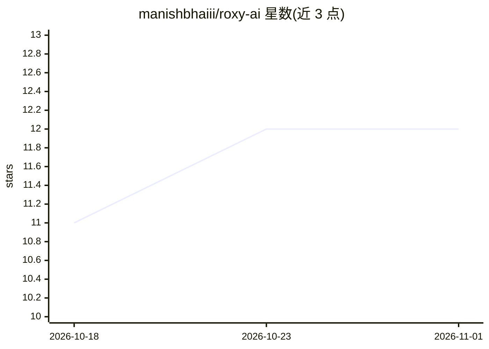

# manishbhaiii/roxy-ai

⭐ 12 · JavaScript · 推送 2026-09-23 · [GitHub](https://github.com/manishbhaiii/roxy-ai) · 个人维护

**面向 Discord 的 AI agent harness（README 未提供细节）**

仓库主题标签指向 Discord 机器人与 AI agent harness，README 仅包含一个指向 start.js 文件的下载链接，未说明功能、机制、安装步骤或运行方式。无可验证的能力描述、依赖清单或使用示例。基于主题标签可归为面向 Discord 平台的 AI agent 接入工具，具体能力与目标用户无法从现有资料确认。

## 筛选速览

| 维度 | 判定 | 备注 |
|---|---|---|
| AI 角色 | `ai-ecosystem` | LLM/agent 周边工具 |
| 许可风险 | `none` | — |
| 部署形态 | `None` |  |
| 模型依赖 | — | README 未给出锁定关系 |
| 硬件要求 | — | 无带数字的原话,不猜 |
| 安装摩擦 | `low` | 无编译、无系统依赖或容器化 |
| 成熟度 | — | 结构信号不足 |

## 能力要点

- README 仅提供 start.js 文件下载链接
- 主题标签覆盖 ai-agent 与 discord-bot

## 适用场景

- 无法从 README 确认具体使用场景

## 场景标签

 · 领域:AI agent/Discord 应用

## 证据(README 行号)

> L1: <a href="https://github.com/manishbhaiii/roxy-ai/blob/main/start.js">

## 星数曲线

2026-10-18 11 → 2026-11-01 12（+1）

---
*卡片 v1 · prompt 1.4 · 生成 2026-11-01 · 置信度 low · 依据 README sha `8d559143f5c6` · [字段定义](../../DATASET.md)*
