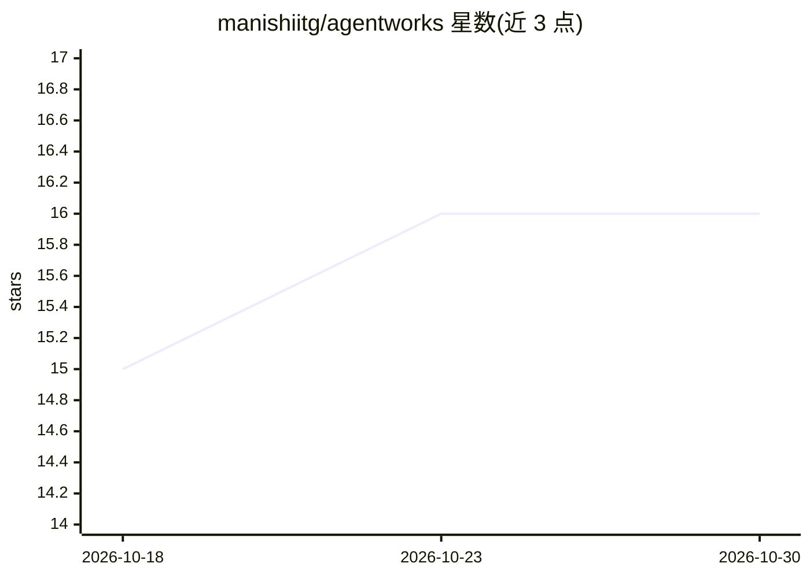

# manishiitg/agentworks

⭐ 16 · Go · NOASSERTION · 推送 2026-10-29 · [GitHub](https://github.com/manishiitg/agentworks) · [官网](https://agentworkshq.com/) · 个人维护

**目标驱动 AI agent 平台：给目标与指标，agent 持续运行直至达标**

源码可用的桌面/自托管平台（BSL 1.1），运行在用户已有的 coding-agent CLI（Claude Code、Codex、Cursor、Pi、Muse）之上：为每个工作流定义目标、主指标与约束，agent 按计划运行、度量结果并自动修改方案直至指标改善。提供 Crew 常驻队友（Slack/WhatsApp 交互）、23 个 Playbook、分级自治、审批与沙箱。macOS Apple Silicon 提供安装脚本与 dmg，未签名需清除隔离标志；也可用 Go+Node 从源码运行，支持 Linux 自托管。

## 筛选速览

| 维度 | 判定 | 备注 |
|---|---|---|
| AI 角色 | `ai-ecosystem` | LLM/agent 周边工具 |
| 许可风险 | `none` | NOASSERTION |
| 部署形态 | `desktop` | 安装包/桌面程序 |
| 模型依赖 | — | README 未给出锁定关系 |
| 硬件要求 | — | 无带数字的原话,不猜 |
| 安装摩擦 | `low` | 无编译、无系统依赖或容器化 |
| 成熟度 | — | 结构信号不足 |

## 能力要点

- 目标+指标驱动的工作流，agent 自动复盘并调整方案
- 调用 Claude Code / Codex / Cursor / Pi / Muse 等已有 CLI 订阅
- Crew 常驻 agent 经 Slack/WhatsApp 对话，支持任意 MCP server
- OS 级沙箱（Landlock/sandbox-exec）、密钥库、运行与成本日志
- 本体亦为 MCP server，可被 ChatGPT/Claude 等 MCP 客户端调用

## 适用场景

- 让 agent 持续做销售外联、增长分析等以指标为目标的工作
- 在 Slack/WhatsApp 里与常驻 AI 队友协作并启动运行
- 把 23 个现成 Playbook（QA、FinOps、安全等）装进工作流复用

## 场景标签

`Agent 框架` `多智能体` `工作流自动化` · 领域:Agent 开发

## 证据(README 行号)

> L5: AgentWorks is a source-available platform for goal-driven AI agents. You describe an outcome, pick the number that p
> L51: - **Coding-agent CLIs:** Claude Code, OpenAI Codex CLI, Cursor CLI, Pi CLI (Gemini, OpenRouter, and other Pi provid
> L54: - **Your AI app:** AgentWorks is also an MCP server. Connect ChatGPT, Claude (Desktop, Code, Cowork), or any MCP cl

## 星数曲线

2026-10-18 15 → 2026-10-30 16（+1）

---
*卡片 v1 · prompt 1.4 · 生成 2026-10-30 · 置信度 high · 依据 README sha `9ac35aa47897` · [字段定义](../../DATASET.md)*
