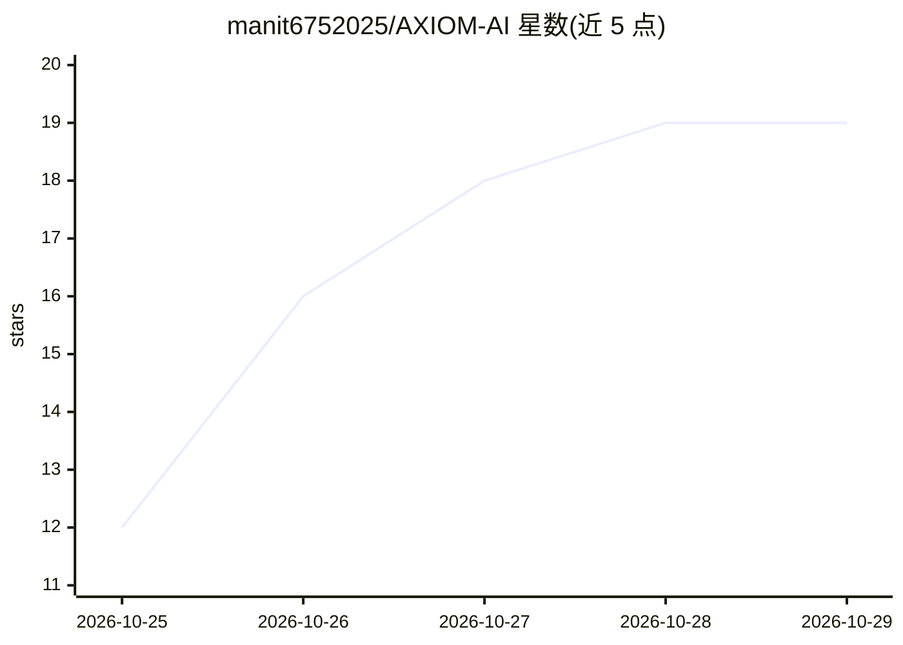

# manit6752025/AXIOM-AI

⭐ 19 · Python · MIT · 推送 2026-10-26 · [GitHub](https://github.com/manit6752025/AXIOM-AI) · [官网](https://manit6752025.github.io/AXIOM-AI/) · 个人维护

**本地优先的 AI 工作台：训练前检查模型、数据与硬件适配**

面向本地开发者的 AI 项目准备与运行工具集：检查模型文件夹与 Hugging Face 仓库、校验和清洗 JSONL 数据集、检测 CPU/RAM/GPU/VRAM 并估算模型是否放得下、生成硬件感知的 LoRA/QLoRA 训练计划（不启动任务）、可选本地 LoRA 微调。自带基于 PyTorch 的 AXIOM Engine 做本地文本推理（GGUF 会去量化为浮点执行，不提供低比特推理），并统一接入 Ollama、OpenAI、Anthropic 等多种 LLM 后端。提供 CLI、浏览器 Control Center 与默认拒绝权限的 MCP server。仍处 beta，计划仅为估算。

## 筛选速览

| 维度 | 判定 | 备注 |
|---|---|---|
| AI 角色 | `ai-ecosystem` | LLM/agent 周边工具 |
| 许可风险 | `permissive` | MIT |
| 部署形态 | `self-host` | docker 或自建部署 |
| 模型依赖 | local-ok | 支持本地模型 |
| 硬件要求 | — | 无带数字的原话,不猜 |
| 安装摩擦 | `low` | 无编译、无系统依赖或容器化 |
| 成熟度 | `idea` | |

## 能力要点

- 模型/数据集/硬件三项事前检查与 VRAM 适配估算
- 自带 PyTorch 推理引擎，支持 Llama/Mistral/Qwen2/Qwen3 及 GGUF 去量化加载（全量/层流/磁盘流）
- 统一 LLM 客户端接入 AXIOM Engine、Ollama、OpenAI、Anthropic、Gemini、DeepSeek 等
- MCP server 供 AI agent 以默认拒绝权限调用工具

## 适用场景

- 花 GPU 时间前确认模型和数据集能在我的机器上跑
- 校验 JSONL 数据集并在 CI 中作为质量门禁
- 规划并保存 LoRA/QLoRA 微调实验方案
- 本地跑小模型推理并用统一客户端切换后端

## 场景标签

`微调` `推理引擎` `MLOps` · 领域:训练与推理

## 证据(README 行号)

> L13: Inspect models, clean datasets, read your hardware, plan training, run local inference, and let AI agents use all o
> L111: |**Training**|Hardware-aware plans, saved experiment history, optional local LoRA fine-tuning|`axiom train plan 7 
> L113: |**Unified LLM client**|One local/cloud client for AXIOM Native Engine, Ollama (including GGUF via Ollama), OpenAI
> L119: |**MCP server**|Let AI agents call AXIOM tools with default-deny permissions|`axiom mcp serve`|

## 星数曲线

2026-10-25 12 → 2026-10-29 19（+7）

---
*卡片 v1 · prompt 1.4 · 生成 2026-10-29 · 置信度 high · 依据 README sha `943f40c95a54` · [字段定义](../../DATASET.md)*
