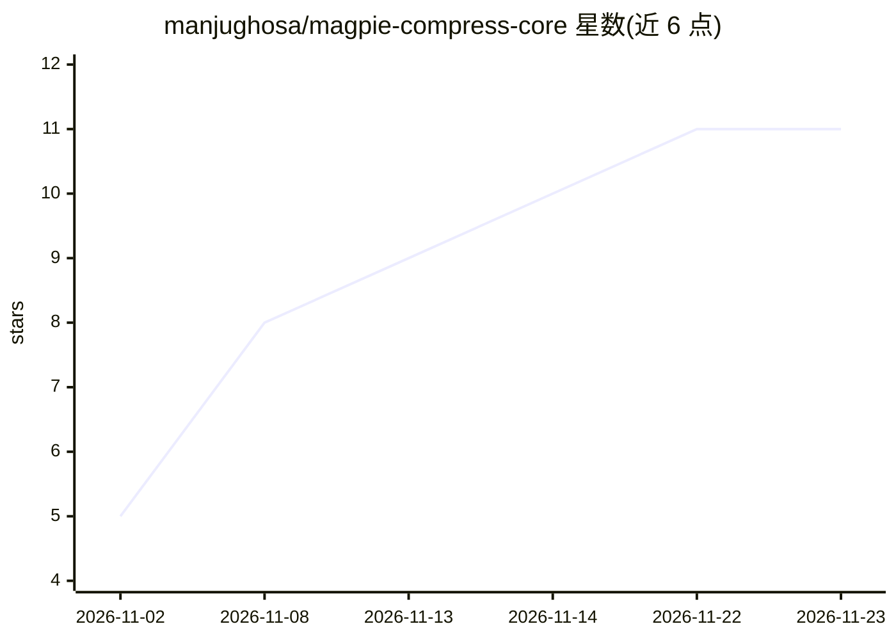

# manjughosa/magpie-compress-core

⭐ 11 · JavaScript · MIT · 推送 2026-11-22 · [GitHub](https://github.com/manjughosa/magpie-compress-core) · 个人维护 · 中文 README

**magpie 网关的上下文压缩插件：请求发出前改写 messages 降字节**

面向 magpie 网关的中间件插件，在请求离开本机前对 messages 做规则式改写：提供 16 个压缩策略（去重、内容寻址替换、工具输出裁剪、句子打分、摘要等）与关闭/稳妥/自定义/全开四档预设，附独立页面、设置面板与用量面板。ccr 策略将原文存本地 store，模型可通过 MCP retrieve 工具取回；门控在未识别取回能力时放弃压缩。默认对前缀做稳定改写以配合 prompt cache。依赖 magpie 网关运行，两个策略在插件宿主中不可用。

## 筛选速览

| 维度 | 判定 | 备注 |
|---|---|---|
| AI 角色 | `ai-ecosystem` | LLM/agent 周边工具 |
| 许可风险 | `permissive` | MIT |
| 部署形态 | `None` |  |
| 模型依赖 | — | README 未给出锁定关系 |
| 硬件要求 | — | 无带数字的原话,不猜 |
| 安装摩擦 | `low` | 无编译、无系统依赖或容器化 |
| 成熟度 | — | 结构信号不足 |

## 能力要点

- 16 个策略按 stackPriority 执行，可单独开关与调参，四档预设
- ccr 策略保留原文于本地 store，配套零依赖 MCP server 提供全文/头尾/行区间/grep 取回
- 取回能力门控：三条路径均不成立时不压缩，原样放行
- lite 策略严格前缀稳定改写，配合上游 prompt cache；页面与文档中英双语

## 适用场景

- 给经过 magpie 网关的长对话请求减字节
- 需要在压缩的同时让模型按需取回原文的工作流
- 调试压缩策略对具体文本的实际改动

## 场景标签

 · 领域:LLM 基础设施/网关中间件

## 证据(README 行号)

> L5: 给 magpie 网关用的上下文压缩插件。它在请求离开本机之前改写 `messages`，把重复的、噪声的、格式化的部分去掉，然后照原样交给上游。
> L17: 装完 `magpie plugin list` 里应该能看到这个插件声明了 `middleware`、`hooks`、`page` 和一个 `usage` 面板。
> L36: |`llmlingua`|LLMLingua-2|35|是|不可用|需要 ONNX 模型与 worker 线程，插件宿主里跑不了。|

## 星数曲线

2026-11-02 5 → 2026-11-23 11（+6）

---
*卡片 v1 · prompt 1.4 · 生成 2026-11-19 · 置信度 high · 依据 README sha `077f1d4ac982` · [字段定义](../../DATASET.md)*
