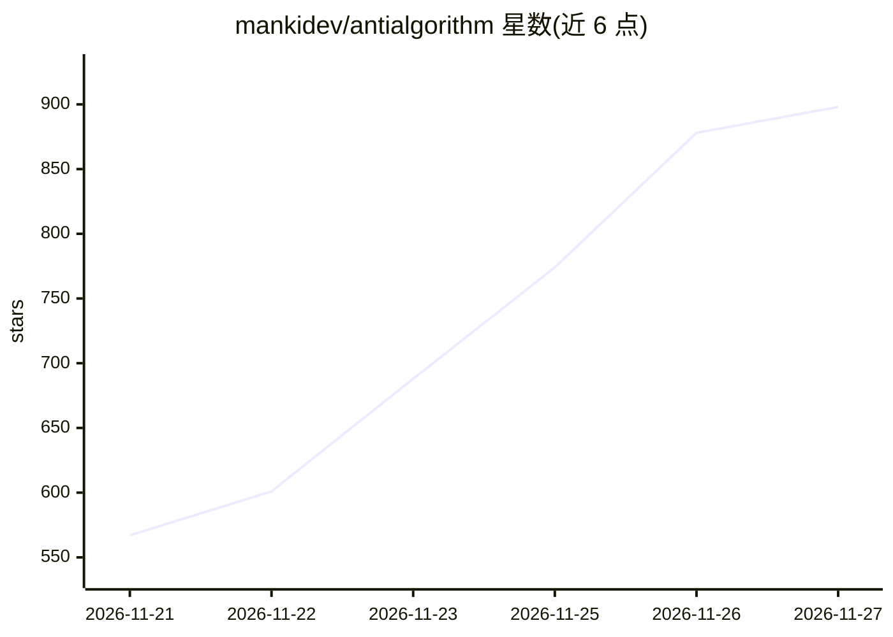

# mankidev/antialgorithm

⭐ 898 · Python · MIT · 推送 2026-11-26 · [GitHub](https://github.com/mankidev/antialgorithm) · 个人维护

**让 AI agent 远离平庸首选答案的创意技能包**

一个面向创意工作的 agent 技能：命名、故事、游戏点子、海报、UI。机制是让模型先说出其最初、最平均的选择，再基于项目理由移开。附四个 Python 脚本：seed.py 用系统随机性生成视觉/文本/创意起点并保存历史避免重复；moves.py 记录每次非默认答案的手法避免复用；rough.py 抖动 SVG 线条产生手作感；check.py 渲染 SVG 检查文字越界、遮挡、对比度等问题。支持 skills CLI、git clone 及 Claude Code 插件三种安装方式，脚本需 Python 3。

## 筛选速览

| 维度 | 判定 | 备注 |
|---|---|---|
| AI 角色 | `ai-native` | 本体是模型或模型工具 |
| 许可风险 | `permissive` | MIT |
| 部署形态 | `library` | 以包/库形式分发 |
| 模型依赖 | — | README 未给出锁定关系 |
| 硬件要求 | — | 无带数字的原话,不猜 |
| 安装摩擦 | `low` | 无编译、无系统依赖或容器化 |
| 成熟度 | — | 结构信号不足 |

## 能力要点

- 先暴露模型的平均首选，再依据项目理由主动偏离
- seed.py 基于系统随机性生成起点并跨会话去重
- rough.py 与 check.py 提供 SVG 手作化处理与排版检查
- 支持 skills CLI 安装及 Claude Code 插件方式

## 适用场景

- 给项目、产品或游戏起名时避免平庸选项
- 让 agent 生成海报/SVG 时保持手作风格
- 为创意写作或 UI 设计引入随机起点

## 场景标签

`AI 写作` · 领域:内容生成

## 证据(README 行号)

> L13: Agent skill for creative work: names, story, game ideas, posters, UI. It makes the model name its first, most avera
> L21: The skills CLI puts it where your agent reads skills, for Codex, Cursor, OpenCode, Claude Code and others:

## 星数曲线

2026-11-21 567 → 2026-11-27 898（+331）

---
*卡片 v1 · prompt 1.4 · 生成 2026-11-27 · 置信度 high · 依据 README sha `605f7ec2836c` · [字段定义](../../DATASET.md)*
