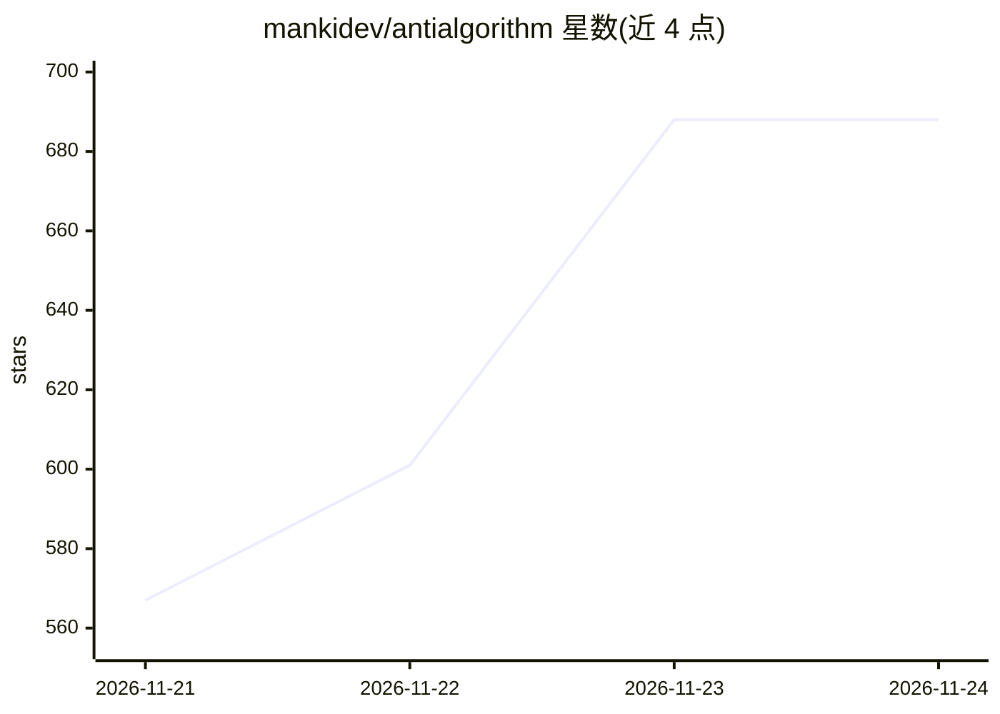

# mankidev/antialgorithm

⭐ 774 · Python · MIT · 推送 2026-11-20 · [GitHub](https://github.com/mankidev/antialgorithm) · 个人维护 · 中文 README

**面向创意工作的 Agent 技能：让模型脱离首个平均化选择**

一个安装到 Agent 技能目录的技能，作用于命名、故事、游戏创意、海报、UI 等创意任务：先让模型说出其第一个、最平均的候选，再基于项目理由主动偏离该选择。附带四个 Python 脚本：seed.py 用系统随机数生成视觉/文本/创意起点并记录历史避免重复，moves.py 记录并防止复用既往手法，rough.py 扰动 SVG 线条与间距制造手作感，check.py 渲染 SVG 并检查文字溢出、遮挡、对比度与尺寸。通过 skills CLI、git clone 或 Claude Code 插件安装。

## 筛选速览

| 维度 | 判定 | 备注 |
|---|---|---|
| AI 角色 | `ai-native` | 本体是模型或模型工具 |
| 许可风险 | `permissive` | MIT |
| 部署形态 | `library` | 以包/库形式分发 |
| 模型依赖 | — | README 未给出锁定关系 |
| 硬件要求 | — | 无带数字的原话,不猜 |
| 安装摩擦 | `low` | 无编译、无系统依赖或容器化 |
| 成熟度 | — | 结构信号不足 |

## 能力要点

- 先陈述首个平均化选择再基于项目理由偏离的工作机制
- seed.py 生成视觉/文本/创意三类种子并保存历史去重
- rough.py 扰动 SVG 使代码绘制的图形呈手作质感
- check.py 渲染 SVG 并列出溢出、遮挡、低对比度、过小文字

## 适用场景

- 让 Agent 为项目生成不落俗套的命名或口号
- 用同一提示词批量产出风格差异更大的海报 SVG
- 检查生成的 SVG 海报中文字溢出与对比度问题
- 在 Cursor/Claude Code 等 Agent 中提升创意产出多样性

## 场景标签

`提示工程` `AI 写作` · 领域:Agent 开发

## 证据(README 行号)

> L13: Agent skill for creative work: names, story, game ideas, posters, UI. It makes the model name its first, most avera
> L19: ## Install

## 星数曲线

2026-11-21 567 → 2026-11-24 688（+121）

---
*卡片 v1 · prompt 1.4 · 生成 2026-11-21 · 置信度 high · 依据 README sha `dc693aa55b78` · [字段定义](../../DATASET.md)*
