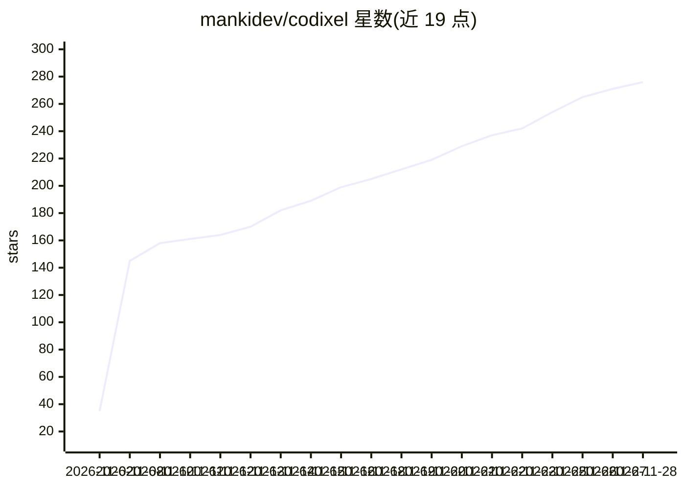

# mankidev/codixel

⭐ 276 · JavaScript · MIT · 推送 2026-11-02 · [GitHub](https://github.com/mankidev/codixel) · 个人维护

**教 Claude Code 用代码制作像素画与游戏动画技能包**

Codixel 是安装在 Claude Code 中的 skill（知识/提示集），用于指导 AI 以写代码的方式生成像素画游戏素材：角色、精灵动画及火焰、烟雾、光束等特效。内容覆盖参考图到成品的分步流程、动物脊椎结构建模、抖动着色、色相偏移、描边等技法，并强调逐步检查 AI 输出的工作方式。通过 git clone 安装到 ~/.claude/skills 后随 Claude Code 加载。

## 筛选速览

| 维度 | 判定 | 备注 |
|---|---|---|
| AI 角色 | `ai-knowledge` | 知识聚合/清单类 |
| 许可风险 | `permissive` | MIT |
| 部署形态 | `None` |  |
| 模型依赖 | — | README 未给出锁定关系 |
| 硬件要求 | — | 无带数字的原话,不猜 |
| 安装摩擦 | `low` | 无编译、无系统依赖或容器化 |
| 成熟度 | — | 结构信号不足 |

## 能力要点

- 覆盖参考图→像素化→骨骼→动画→入场景检查的完整分步流程
- 内置 dither 抖动、hue shifting、描边与 rim light 等像素画技法规则
- 通过 git clone 安装到 Claude Code skills 目录，下次启动自动加载
- 支持火焰、烟雾、光束、水波等多种游戏特效生成流程

## 适用场景

- 为独立游戏生成角色精灵与动画帧
- 制作火焰、烟雾、瀑布等像素风格游戏特效
- 把参考图逐帧转成可动的像素画素材

## 场景标签

`图像生成` · 领域:内容生成

## 证据(README 行号)

> L5: Codixel is a Claude Code skill for making pixel art with AI: game sprites, characters, animations and effects like f
> L99: git clone https://github.com/mankidev/codixel ~/.claude/skills/codixel
> L102: Claude Code loads it on the next start. It runs when you ask for pixel art.

## 星数曲线

2026-11-02 35 → 2026-11-28 276（+241）

---
*卡片 v1 · prompt 1.4 · 生成 2026-11-25 · 置信度 high · 依据 README sha `a3e414ac365e` · [字段定义](../../DATASET.md)*
