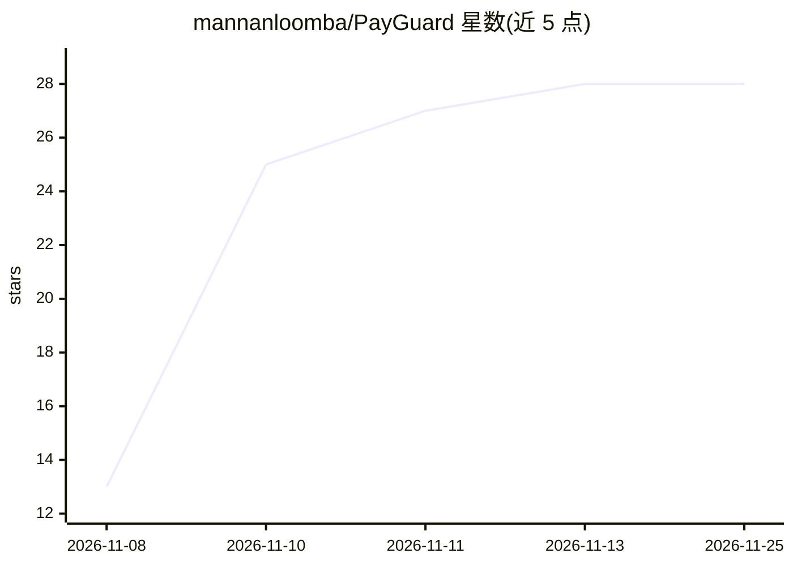

# mannanloomba/PayGuard

⭐ 28 · Python · 推送 2026-11-06 · [GitHub](https://github.com/mannanloomba/PayGuard) · [官网](https://payguard-vqu7.onrender.com/) · 个人维护

**支付安全工作台：AI 解析账单与 UPI 二维码，沙箱流程需人工批准**

面向终端用户的支付审查应用：上传 PDF/图片后由 PyMuPDF 与 Tesseract 本地 OCR 提取文本，交由 BharatCode Qwen 生成结构化账单字段，用户可修改后保存；系统以确定性规则计算 0-100 风险分（低/中/高），AI 仅负责解释证据；浏览器本地解码 UPI 二维码并展示收款方与金额供确认；另有受限 AI 助手与支出分析。所有支付结果均为沙箱模拟，不连接真实银行或 UPI 网络。部署定位为单人黑客松演示。

## 筛选速览

| 维度 | 判定 | 备注 |
|---|---|---|
| AI 角色 | `ai-native` | 本体是模型或模型工具 |
| 许可风险 | `none` | — |
| 部署形态 | `desktop` | 安装包/桌面程序 |
| 模型依赖 | — | README 未给出锁定关系 |
| 硬件要求 | — | 无带数字的原话,不猜 |
| 安装摩擦 | `low` | 无编译、无系统依赖或容器化 |
| 成熟度 | `idea` | |

## 能力要点

- 本地 OCR 提取文本后才交 AI 结构化账单字段，用户可修改后保存
- 确定性 0-100 启发式风险评分，AI 仅解释证据不产出权威概率
- 浏览器本地解码并严格解析 upi://pay 二维码，审阅后才能准备请求
- 支付提案具备过期、一次性确认与重放保护，需显式批准才记录沙箱结果

## 适用场景

- 付款前审查账单明细、重复发票与收款方信息
- 解码 UPI 付款二维码并核对收款人与金额再决定
- 查看分类支出、预算与趋势，并获取基于聚合数据的 AI 观察

## 场景标签

`网络安全` `OCR` `数据分析` · 领域:效率与自动化

## 证据(README 行号)

> L18: > **The one-line pitch:** PayGuard turns payment intent into a reviewable decision — extracting context, checking h
> L62: 3. Only extracted text is sent to BharatCode Qwen for structured field interpretation.
> L80: The score and level remain deterministic. AI explains the evidence; it does not invent an authoritative fraud proba

## 星数曲线

2026-11-08 13 → 2026-11-25 28（+15）

---
*卡片 v1 · prompt 1.4 · 生成 2026-11-18 · 置信度 mid · 依据 README sha `0e2182e19be2` · [字段定义](../../DATASET.md)*
