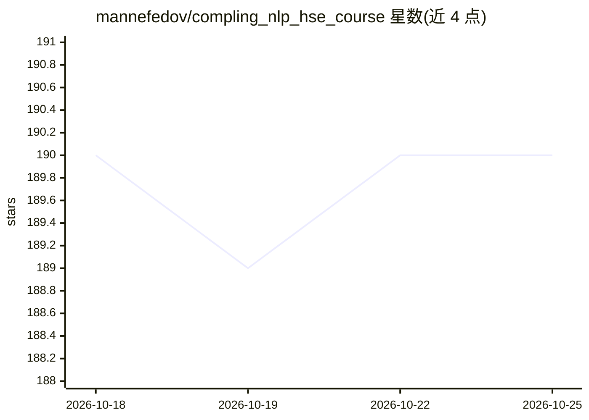

# mannefedov/compling_nlp_hse_course

⭐ 190 · Jupyter Notebook · 推送 2026-10-25 · [GitHub](https://github.com/mannefedov/compling_nlp_hse_course) · 组织维护

**HSE 计算语言学课程的教学材料合集（Jupyter 笔记本）**

俄罗斯高等经济学院（НИУ ВШЭ）语言学学院的计算语言学/自然语言处理课程材料仓库，主体为一系列 Jupyter 笔记本。内容按模块组织：入门部分涵盖正则、n-gram、词义消歧、语言分类与 LLM 基础使用；主体部分覆盖文本预处理、词袋分类、拼写纠错、语言建模、词向量、CNN/RNN、NER、BERT、GPT、机器翻译、指令微调与量化/PEFT、强化学习及多模态（视觉/音频）等主题。面向课程学习者，提供 Python 生态工具（pymorphy、mystem、razdel 等）的实践材料。

## 筛选速览

| 维度 | 判定 | 备注 |
|---|---|---|
| AI 角色 | `ai-knowledge` | 知识聚合/清单类 |
| 许可风险 | `none` | — |
| 部署形态 | `None` |  |
| 模型依赖 | — | README 未给出锁定关系 |
| 硬件要求 | — | 无带数字的原话,不猜 |
| 安装摩擦 | `low` | 无编译、无系统依赖或容器化 |
| 成熟度 | — | 结构信号不足 |

## 能力要点

- 覆盖预处理到 BERT/GPT、机器翻译、微调量化的 15 个主题笔记本
- 含基础 LLM 使用与多模态（视觉/音频）章节
- 使用 pymorphy、mystem、razdel 等俄语 NLP 工具

## 适用场景

- 跟随课程系统学习 NLP 从基础到 LLM 的内容
- 查找俄语文本处理的工具与实践示例
- 作为教学参考材料复用

## 场景标签

`教程课程` · 领域:学习与行业

## 证据(README 行号)

> L1: ## Материалы курса по компьютерной лингвистике (Natural Language Processing course materials)
> L3: ### Jupyter-ноутбуки курса
> L14: 1. **Предобработка текста (Text preprocessing)**

## 星数曲线

2026-10-18 190 → 2026-10-25 190（+0）

---
*卡片 v1 · prompt 1.4 · 生成 2026-10-22 · 置信度 high · 依据 README sha `ae171841ce1f` · [字段定义](../../DATASET.md)*
