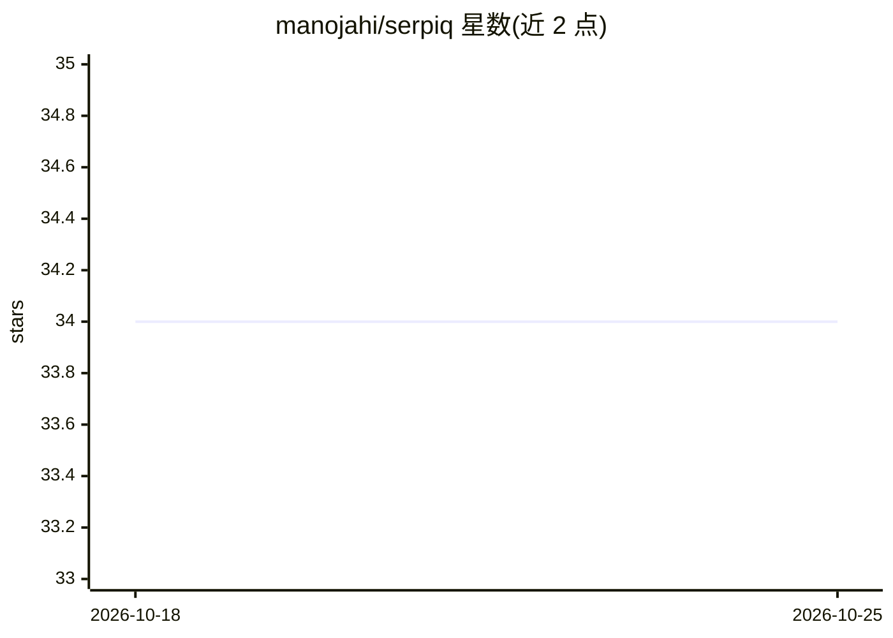

# manojahi/serpiq

⭐ 34 · TypeScript · MIT · 推送 2026-04-28 · [GitHub](https://github.com/manojahi/serpiq) · [官网](https://manojahi.github.io/serpiq/) · 个人维护

**面向开发者站点的 SEO 审计 CLI：读代码库并接入真实 GSC 数据**

零安装的 Node.js CLI（TypeScript）：先读取项目 README、package.json、落地页等理解产品，再通过 OAuth 接入 Google Search Console 拉取 90 天真实查询与页面数据，结合 Google Autocomplete 抓取做关键词研究，由 LLM 生成健康评分、快速修复项、博客内容简报与 pSEO 页面模板，输出到 .serpiq/ 目录。LLM 采用自带密钥模式，支持 Anthropic/OpenAI/OpenRouter/OpenAI 兼容 API/本地 Ollama；需自建 GSC OAuth 凭据，明确不使用第三方关键词量 API 与竞品 SERP 抓取。

## 筛选速览

| 维度 | 判定 | 备注 |
|---|---|---|
| AI 角色 | `ai-native` | 本体是模型或模型工具 |
| 许可风险 | `permissive` | MIT |
| 部署形态 | `library` | 以包/库形式分发 |
| 模型依赖 | local-ok | 支持本地模型 |
| 硬件要求 | — | 无带数字的原话,不猜 |
| 安装摩擦 | `low` | 无编译、无系统依赖或容器化 |
| 成熟度 | — | 结构信号不足 |

## 能力要点

- 读取代码库（README/package.json/落地页）做产品感知审计
- 直接拉取 Google Search Console 90 天真实展示/点击/排名数据
- 生成健康评分、striking-distance 关键词、博客简报与 pSEO 模板
- 支持自带 LLM：Anthropic/OpenAI/OpenRouter/OpenAI 兼容/本地 Ollama

## 适用场景

- 给自己的开发者产品站点做一次基于真实数据的 SEO 体检
- 找出排名 8-20 的临界关键词并生成内容计划
- 生成可直接执行的博客写作简报与程序化页面模板

## 场景标签

`网页抓取` `数据分析` · 领域:效率与自动化

## 证据(README 行号)

> L9: > The only SEO audit tool that reads your codebase first, then pulls your real Google Search Console data.
> L11: `serpiq` is a zero-install CLI that reads your project, pulls real Google Search Console data, does keyword researc
> L108: `serpiq` uses an LLM for product understanding, keyword research, and the strategy report. You choose the provider

## 星数曲线

2026-10-18 34 → 2026-10-25 34（+0）

---
*卡片 v1 · prompt 1.4 · 生成 2026-10-25 · 置信度 high · 依据 README sha `9ea30c038e38` · [字段定义](../../DATASET.md)*
