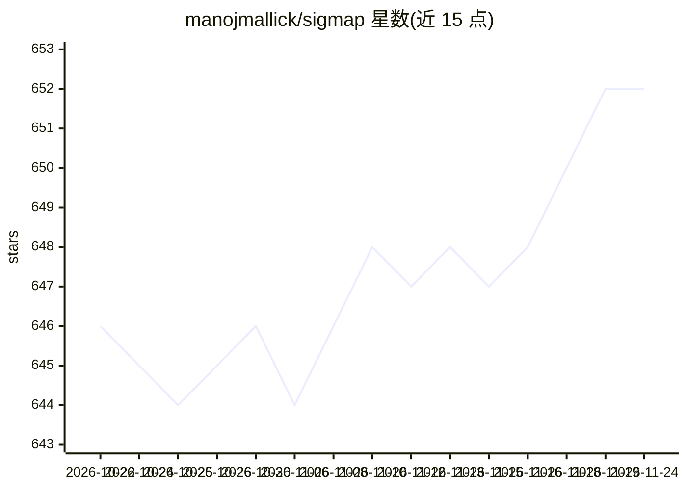

# manojmallick/sigmap

⭐ 652 · JavaScript · MIT · 推送 2026-11-21 · [GitHub](https://github.com/manojmallick/sigmap) · [官网](https://sigmap.io/) · 个人维护

**为 AI 编码会话生成确定性代码签名图与核查工具**

SigMap 对代码库构建确定性、可审计的签名与证据图，不调用 LLM、无嵌入、输出字节级稳定，供 AI agent、CI 和评审者在操作前核验文件与符号是否真实存在。提供 ask（TF-IDF 文件排序）、verify（核查 AI 回答中虚构的文件/导入/符号）、evidence（机器可读证据包）等命令，并内置 22 个工具的 MCP server 与适配多种助手上下文文件的 adapter。npm 分发，支持独立二进制，零依赖、可离线运行。

## 筛选速览

| 维度 | 判定 | 备注 |
|---|---|---|
| AI 角色 | `ai-ecosystem` | LLM/agent 周边工具 |
| 许可风险 | `permissive` | MIT |
| 部署形态 | `desktop` | 安装包/桌面程序 |
| 模型依赖 | local-ok | 支持本地模型 |
| 硬件要求 | — | 无带数字的原话,不猜 |
| 安装摩擦 | `low` | 无编译、无系统依赖或容器化 |
| 成熟度 | — | 结构信号不足 |

## 能力要点

- 确定性输出：同一仓库每次生成字节级一致的地图，可 diff 与 CI 门禁
- sigmap verify 离线核查 AI 回答中虚构的文件、导入与符号
- MCP server 提供 22 个按需工具（query_context、verify_suggestion 等）
- 支持 38 种语言的签名提取，提供 VS Code/JetBrains/Neovim 扩展

## 适用场景

- 让 AI 编码 agent 使用可审计的代码上下文而非复制粘贴
- 在 CI 中将 verify 作为门禁，拦截 AI 编造的文件与符号
- 用本地模型配合 SigMap 做无 API 成本的代码任务
- 审查 PR 时核查改动范围与缺失测试

## 场景标签

`代码审查` · 领域:编码与开发

## 证据(README 行号)

> L35: SigMap builds a **deterministic, auditable signature-and-evidence map** of your codebase — no LLM calls, no embeddi
> L39: **Model-agnostic.** Works with:
> L43: - **Any editor:** VS Code, Cursor, Windsurf, Neovim, JetBrains

## 星数曲线

2026-10-22 646 → 2026-11-24 652（+6）

---
*卡片 v1 · prompt 1.4 · 生成 2026-11-24 · 置信度 mid · 依据 README sha `d7b1a4a82858` · [字段定义](../../DATASET.md)*
