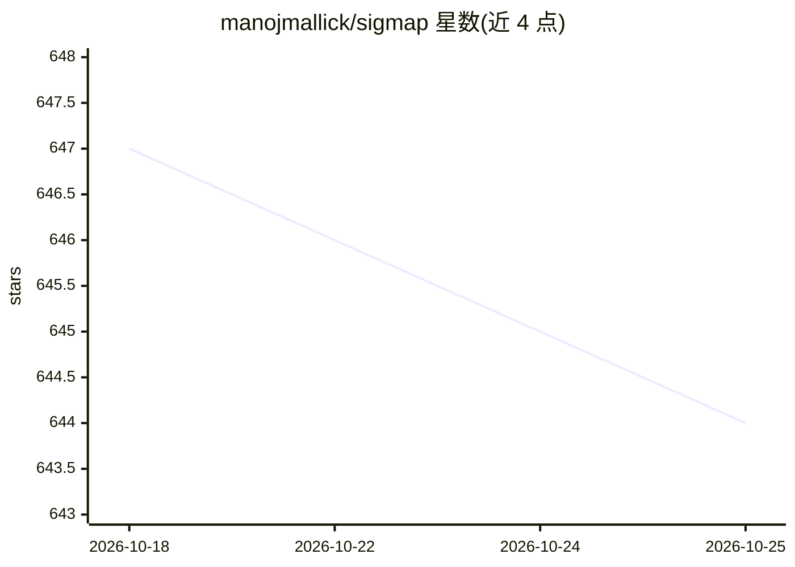

# manojmallick/sigmap

⭐ 644 · JavaScript · MIT · 推送 2026-10-23 · [GitHub](https://github.com/manojmallick/sigmap) · [官网](https://sigmap.io/) · 个人维护

**给 AI 编码代理的代码库签名地图与回答落地校验工具**

面向 AI 编码代理与 CI 的确定性代码上下文层：用 AST 与锚定正则对仓库生成字节稳定的签名地图（支持 38 种语言），通过 TF-IDF 排序输出相关文件、签名与行号锚点；sigmap verify 将 AI 回答中的文件/导入/符号逐一对照实际索引，标记编造内容，可作 CI 门禁（--json 退出码 1）。无 LLM 调用、无嵌入、零依赖、完全离线；以 npx/npm、独立二进制与 MCP server（22 个工具）形式提供，适配 Claude Code、Copilot、Cursor、Ollama 等多种代理与编辑器。Tier-3 格式（Ruby、C/C++ 等）无行号锚点，为已声明限制。

## 筛选速览

| 维度 | 判定 | 备注 |
|---|---|---|
| AI 角色 | `ai-ecosystem` | LLM/agent 周边工具 |
| 许可风险 | `permissive` | MIT |
| 部署形态 | `desktop` | 安装包/桌面程序 |
| 模型依赖 | local-ok | 支持本地模型 |
| 硬件要求 | — | 无带数字的原话,不猜 |
| 安装摩擦 | `low` | 无编译、无系统依赖或容器化 |
| 成熟度 | — | 结构信号不足 |

## 能力要点

- 确定性签名地图：同仓库输入产出字节相同输出，可 diff/缓存/CI 门禁
- sigmap verify 标记 AI 回答中编造的文件/导入/符号/npm 脚本，支持 JSON 报告与 HTML 报告
- MCP server 提供 22 个按需工具（query_context、get_method_impact、verify_suggestion 等）
- 零依赖、无 LLM 调用、无嵌入、完全离线运行

## 适用场景

- 让 Claude Code/Copilot 等编码代理获取可信的仓库签名上下文
- CI 中校验 AI 生成的回答或计划是否锚定到真实文件与符号
- 审计 PR diff 的范围漂移与影响面
- 用本地 LLM（Ollama 等）配合使用且不产生 API 费用

## 场景标签

`代码审查` · 领域:编码与开发

## 证据(README 行号)

> L35: SigMap builds a **deterministic, auditable signature-and-evidence map** of your codebase — no LLM calls, no embeddi
> L209: SigMap doesn't compete with your agent's live search — it's what the live loop **calls for grounding**: grep finds
> L238: SigMap treats coding agents as **consumers, not competitors**: it hands them a deterministic, auditable map the ag

## 星数曲线

2026-10-18 647 → 2026-10-25 644（-3）

---
*卡片 v1 · prompt 1.4 · 生成 2026-10-21 · 置信度 mid · 依据 README sha `448bc3c7368f` · [字段定义](../../DATASET.md)*
