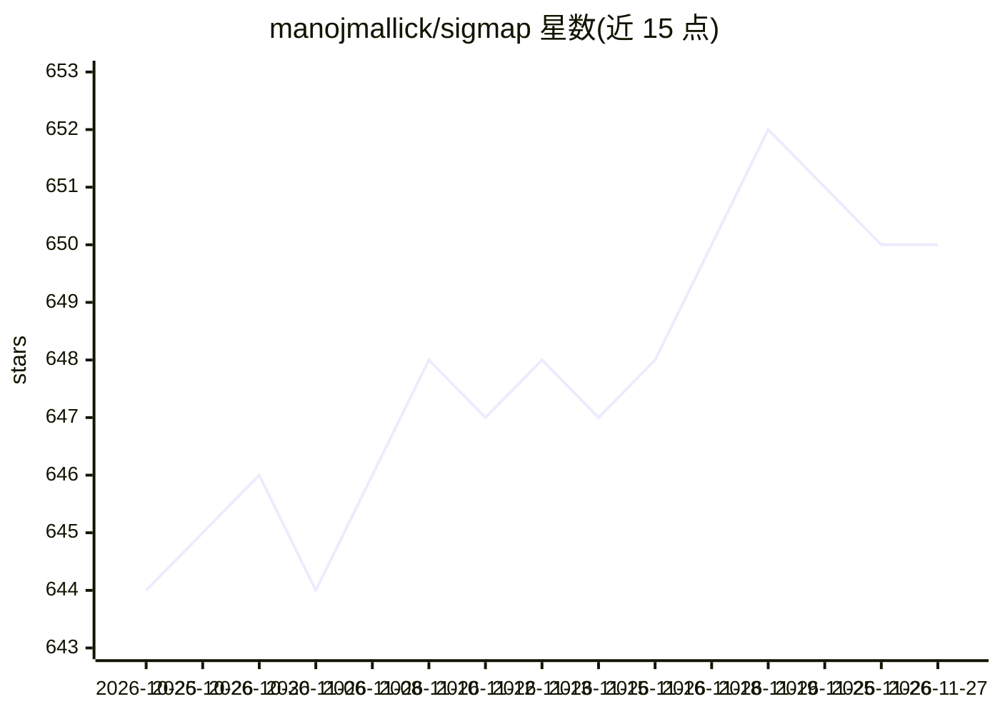

# manojmallick/sigmap

⭐ 650 · JavaScript · MIT · 推送 2026-11-26 · [GitHub](https://github.com/manojmallick/sigmap) · [官网](https://sigmap.io/) · 个人维护

**为 AI 编码会话生成确定性代码签名地图并校验 AI 回答的 CLI**

对代码库构建确定性的签名与证据地图（无 LLM 调用、无嵌入、字节稳定输出），供 AI agent、CI 与审查者在操作前核验文件与符号是否真实存在。`sigmap verify` 离线检查 AI 回答中捏造的文件、导入与符号；提供 ask/rank/judge 等子命令、22 个工具的 MCP 服务器、面向主流 AI 助手的上下文适配器、IDE 扩展与独立二进制。宣称 token 缩减约 95%，附基准数据（其中 Zenodo 快照存在已知缺陷字段）。

## 筛选速览

| 维度 | 判定 | 备注 |
|---|---|---|
| AI 角色 | `ai-ecosystem` | LLM/agent 周边工具 |
| 许可风险 | `permissive` | MIT |
| 部署形态 | `desktop` | 安装包/桌面程序 |
| 模型依赖 | local-ok | 支持本地模型 |
| 硬件要求 | — | 无带数字的原话,不猜 |
| 安装摩擦 | `low` | 无编译、无系统依赖或容器化 |
| 成熟度 | — | 结构信号不足 |

## 能力要点

- 确定性、可审计的签名地图，无 LLM 调用、零依赖、完全离线
- sigmap verify 离线校验 AI 回答中的捏造文件/导入/符号（JSON/HTML 报告，可作 CI 门禁）
- 22 个工具的 MCP 服务器，支持 core/all 工具集配置
- 面向 Copilot/Claude/Cursor/Windsurf 等 8 种适配器输出上下文文件

## 适用场景

- 让 AI agent 消费可复现的代码库上下文而非复制粘贴
- 在 CI 中门禁校验 AI 生成回答是否有真实符号与行号锚点
- 本地 LLM 环境下零 API 成本使用代码上下文
- 审查 AI 提交的 PR（范围漂移、缺测试等）

## 场景标签

`代码审查` · 领域:编码与开发

## 证据(README 行号)

> L35: SigMap builds a **deterministic, auditable signature-and-evidence map** of your codebase — no LLM calls, no embeddi
> L201: **MCP server** — 22 on-demand tools for Claude Code, Codex CLI, OpenCode, Cursor, and other supported clients:

## 星数曲线

2026-10-25 644 → 2026-11-27 650（+6）

---
*卡片 v1 · prompt 1.4 · 生成 2026-11-25 · 置信度 mid · 依据 README sha `b16c3c419da8` · [字段定义](../../DATASET.md)*
