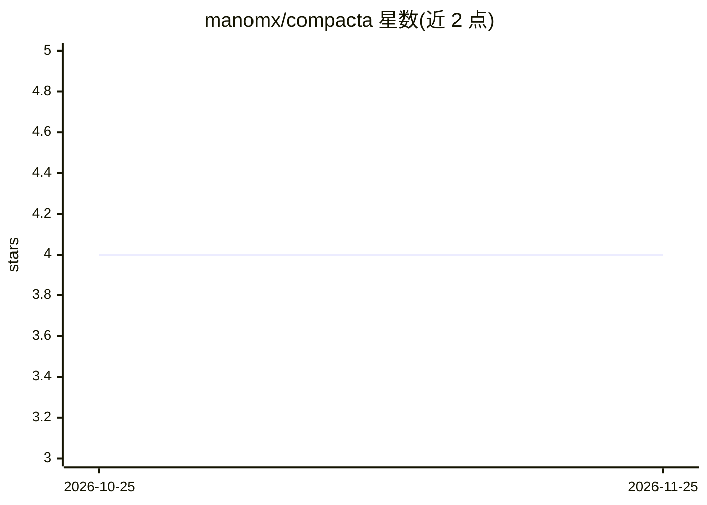

# manomx/compacta

⭐ 4 · JavaScript · MIT · 推送 2026-11-20 · [GitHub](https://github.com/manomx/compacta) · [官网](https://github.com/manomx/compacta#readme) · 个人维护

**为 Codex/Claude Code 后台预生成对话摘要的 macOS 伴侣应用**

运行在 Apple Silicon Mac 上的原生 SwiftUI 应用，在编码 agent 长会话运行时后台准备对话摘要，当 Codex 请求 compaction 时应用已备好的 checkpoint，保留近期完整步骤并在历史变化时校验摘要可复用性。摘要模型可自选：支持 OpenAI Responses、OpenAI 兼容 Chat Completions 与 Anthropic 格式。通过本地 loopback 网关运行，状态存于本机，API key 存入 macOS Keychain；界面提供英/西/简中三种语言。无固定延迟保证，摘要请求消耗 provider 配额。

## 筛选速览

| 维度 | 判定 | 备注 |
|---|---|---|
| AI 角色 | `ai-ecosystem` | LLM/agent 周边工具 |
| 许可风险 | `permissive` | MIT |
| 部署形态 | `desktop` | 安装包/桌面程序 |
| 模型依赖 | locked-api |  |
| 硬件要求 | — | 无带数字的原话,不猜 |
| 安装摩擦 | `low` | 无编译、无系统依赖或容器化 |
| 成熟度 | — | 结构信号不足 |

## 能力要点

- 后台准备对话摘要，Codex 请求 compaction 时应用 checkpoint
- 支持 OpenAI Responses、OpenAI 兼容接口与 Anthropic 三种摘要格式
- 本地 loopback 网关，API key 存入 macOS Keychain，无云端后端
- 菜单栏活动视图显示准备状态、token 用量与费用估算

## 适用场景

- 长编码会话中提前准备更小的上下文以备压缩
- 同时使用 Codex 与 Claude Code 的开发者统一管理摘要准备
- 关心 API 用量与成本的开发者查看 token 消耗估算

## 场景标签

`编码 Agent` · 领域:编码与开发

## 证据(README 行号)

> L5:  A native macOS companion that prepares conversation summaries while your coding agent works.
> L93:     A[Your coding client] --> B[Local Compacta gateway]

## 星数曲线

2026-10-25 4 → 2026-11-25 4（+0）

---
*卡片 v1 · prompt 1.4 · 生成 2026-11-21 · 置信度 high · 依据 README sha `770faf7d9e5a` · [字段定义](../../DATASET.md)*
