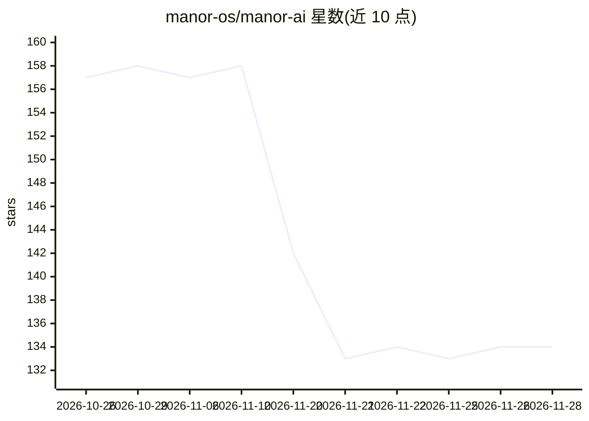

# manor-os/manor-ai

⭐ 134 · Python · NOASSERTION · 推送 2026-11-11 · [GitHub](https://github.com/manor-os/manor-ai) · [官网](https://manorai.xyz) · 组织维护

**自托管 AI agent 工作台：小团队可控运行 agent 并加人工审批**

面向小型企业和精简团队的自托管 AI 工作空间，将聊天、文档、agent、目标、工作流、报告、集成纳入单一运行时。agent 通过目标、任务、工作区上下文与工具权限运作，敏感动作经人工审批门暂停并留审计日志。知识检索基于 PostgreSQL/pgvector，对象存储用 MinIO，后台任务用 Celery。BYOK 模式下模型密钥配置在用户自己的部署中。通过 git clone 与 Docker Compose 一键启动，内置演示账号。托管托管与商业云运营不在本仓库内。

## 筛选速览

| 维度 | 判定 | 备注 |
|---|---|---|
| AI 角色 | `ai-ecosystem` | LLM/agent 周边工具 |
| 许可风险 | `none` | NOASSERTION |
| 部署形态 | `self-host` | docker 或自建部署 |
| 模型依赖 | — | README 未给出锁定关系 |
| 硬件要求 | — | 无带数字的原话,不猜 |
| 安装摩擦 | `low` | 无编译、无系统依赖或容器化 |
| 成熟度 | — | 结构信号不足 |

## 能力要点

- HITL 治理：审批门、工具范围限定、审计日志与工作区权限
- BYOK：模型密钥配置在自有部署中，不需托管模型代理
- pgvector 知识检索、MinIO 存储、Celery 后台任务的完整自托管栈
- FastAPI 开放 API 与 MCP 目录、Webhook、OAuth 集成面

## 适用场景

- 让 agent 基于团队文档知识执行任务并保留证据与审计
- 自动化敏感外部操作前强制人工审批
- 在自有基础设施内运行 agent 而不把数据交给托管黑盒

## 场景标签

`工作流自动化` `RAG` · 领域:效率与自动化

## 证据(README 行号)

> L7:  Self-hosted AI workspace for governed agents, tasks, tools, and knowledge.
> L98: |Agent runtime|Tool-calling loop, model routing, skills, workspace context, task execution, and evidence logs.|

## 星数曲线

2026-10-26 157 → 2026-11-28 134（-23）

---
*卡片 v1 · prompt 1.4 · 生成 2026-11-28 · 置信度 high · 依据 README sha `3546461681c3` · [字段定义](../../DATASET.md)*
