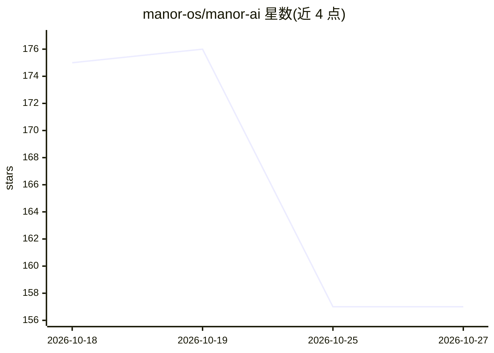

# manor-os/manor-ai

⭐ 157 · Python · NOASSERTION · 推送 2026-10-12 · [GitHub](https://github.com/manor-os/manor-ai) · [官网](https://manorai.xyz) · 组织维护 · 中文 README

**面向小团队的自托管 AI agent 工作区：治理化执行任务**

自托管的 AI 工作区应用，供小企业与精简团队在自有基础设施上运行 agent：提供聊天、目标/任务、文档知识库（PostgreSQL+pgvector 检索、MinIO 存储）、工具调用循环、技能与 MCP 集成。采用 BYOK 模式，模型供应商密钥配置在用户部署内，不依赖托管代理。治理机制包括人工审批门（HITL）、范围化工具、审计日志与工作区权限。技术栈为 React+Vite 前端、FastAPI API、Celery worker，通过 Docker Compose 部署；托管服务与商业云运营在本仓库之外，采用 Sustainable Use License 1.0（source-available，非 OSI 开源许可）。

## 筛选速览

| 维度 | 判定 | 备注 |
|---|---|---|
| AI 角色 | `ai-native` | 本体是模型或模型工具 |
| 许可风险 | `none` | NOASSERTION |
| 部署形态 | `self-host` | docker 或自建部署 |
| 模型依赖 | — | README 未给出锁定关系 |
| 硬件要求 | — | 无带数字的原话,不猜 |
| 安装摩擦 | `low` | 无编译、无系统依赖或容器化 |
| 成熟度 | — | 结构信号不足 |

## 能力要点

- BYOK 模型接入：密钥留在自有部署内，无需托管模型代理
- 人工审批门（HITL）+ 审计日志 + 工作区权限的治理机制
- pgvector 知识检索、MinIO 对象存储、MCP 目录与 Webhook/OAuth 集成
- Docker Compose 一键部署，含沙箱隔离与健康检查

## 适用场景

- 小团队在自有服务器上运行带审批流程的 AI agent 自动化
- 对敏感操作要求人工审核和审计留痕的业务流程
- 把团队文档建成可检索知识库供 agent 调用
- 数据不出自有基础设施的私有化 AI 工作区

## 场景标签

`RAG` · 领域:知识与检索

## 证据(README 行号)

> L7:  Self-hosted AI workspace for governed agents, tasks, tools, and knowledge.
> L45: Manor AI is built for that layer: the product surface where model choice,
> L97: |AI workspace|Chat, goals, tasks, documents, knowledge, reports, agents, and settings in one self-hosted UI.|

## 星数曲线

2026-10-18 175 → 2026-10-27 157（-18）

---
*卡片 v1 · prompt 1.4 · 生成 2026-10-22 · 置信度 high · 依据 README sha `1167e6362115` · [字段定义](../../DATASET.md)*
