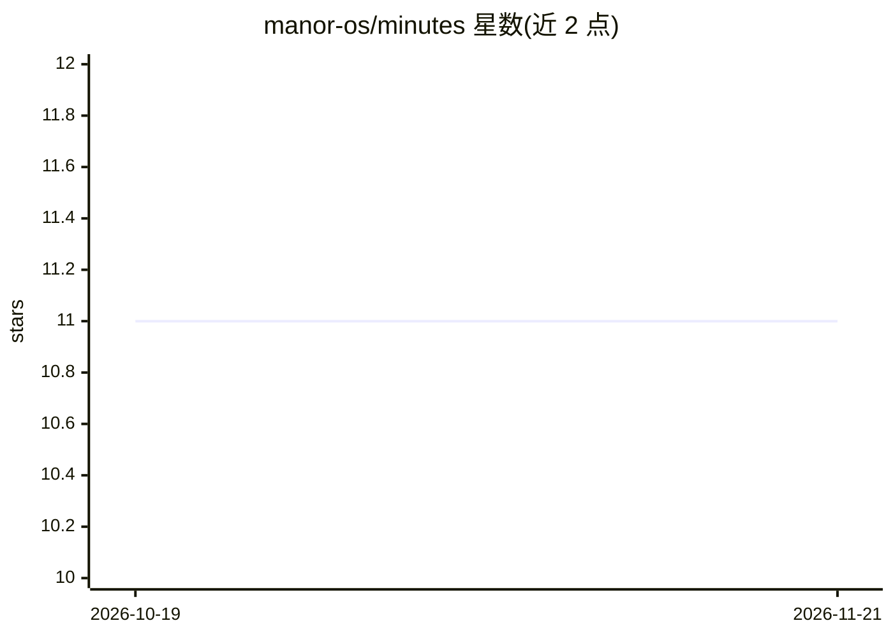

# manor-os/minutes

⭐ 11 · JavaScript · MIT · 推送 2026-10-29 · [GitHub](https://github.com/manor-os/minutes) · [官网](https://minutes.manorai.xyz) · 组织维护 · 中文 README

**面向创始人和小团队的会议记录转写与行动项提取工具**

Minutes 将会议录音转为转写文本、摘要、要点与行动项，支持提问、检索与分享导出。可通过托管服务使用，也可自托管 MIT 版本：Docker Compose 一键部署 React/Vite + FastAPI + Celery/Redis + PostgreSQL + MinIO 技术栈；AI 处理可用自带 API key，或用 faster-whisper 转写与 Ollama 运行 qwen2.5:1.5b 完全本地推理。托管版与社区版功能有差异，自托管不含云 MCP 集成与托管语言选择器。

## 筛选速览

| 维度 | 判定 | 备注 |
|---|---|---|
| AI 角色 | `ai-native` | 本体是模型或模型工具 |
| 许可风险 | `permissive` | MIT |
| 部署形态 | `self-host` | docker 或自建部署 |
| 模型依赖 | local-ok | 支持本地模型 |
| 硬件要求 | — | 无带数字的原话,不猜 |
| 安装摩擦 | `low` | 无编译、无系统依赖或容器化 |
| 成熟度 | — | 结构信号不足 |

## 能力要点

- 录音/上传转转写、摘要、要点与带负责人和截止时间的行动项
- 基于转写文本的会议问答（Ask）
- faster-whisper + Ollama 本地推理，无需付费模型 API
- 只读分享链接、音频/文本下载与打印为 PDF

## 适用场景

- 独自创业者在 Zoom 或电话会后自动整理会议纪要
- 小团队把通话转为带行动项的记录并分享给同事
- 隐私敏感场景下用本地模型做转写与摘要

## 场景标签

`语音识别` · 领域:感知与多模态

## 证据(README 行号)

> L8: Minutes turns recordings into transcripts, summaries, and action items. Ask questions about a meeting, find a past d
> L75: The local overlay selects faster-whisper `base` and Ollama `qwen2.5:1.5b`. Initial image and model downloads requir

## 星数曲线

2026-10-19 11 → 2026-11-21 11（+0）

---
*卡片 v1 · prompt 1.4 · 生成 2026-11-18 · 置信度 high · 依据 README sha `45be5b046a98` · [字段定义](../../DATASET.md)*
