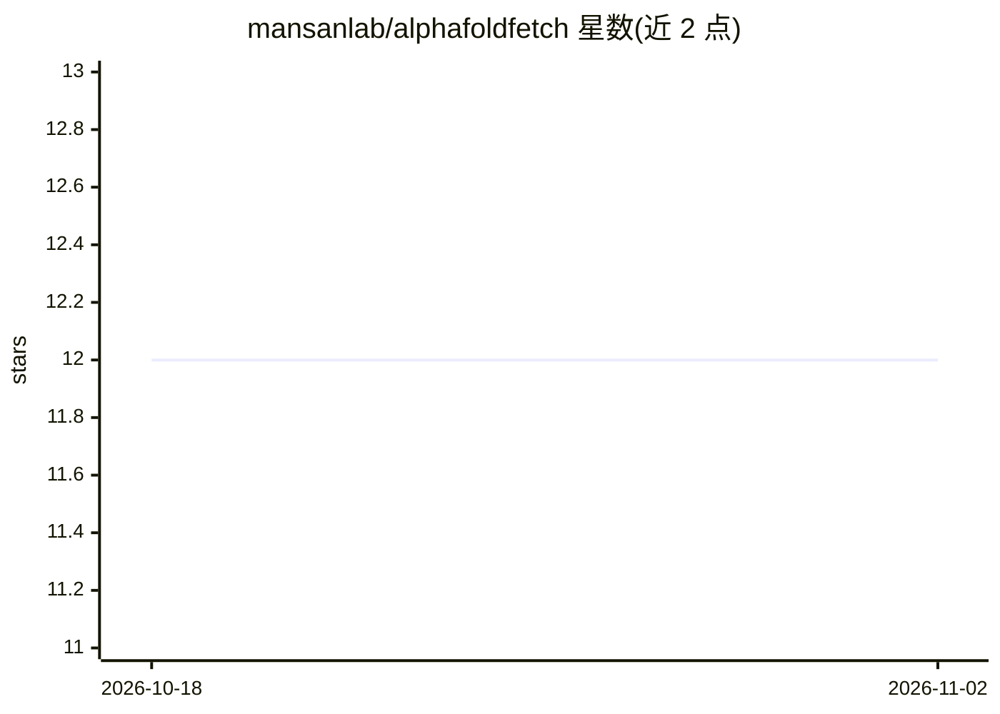

# mansanlab/alphafoldfetch

⭐ 12 · Python · MIT · 推送 2026-05-11 · [GitHub](https://github.com/mansanlab/alphafoldfetch) · [官网](https://mansanlab.github.io/alphafoldfetch/) · 组织维护

**按 UniProt ID 或 FASTA 批量下载 AlphaFold 结构文件的 CLI**

Python 命令行工具 affetch，从 UniProt 登录号、含登录号的字符串、FASTA 文件或 stdin 读取输入，下载 AlphaFold 结构文件（PDB/CIF/可 gzip），支持指定 AlphaFold 模型版本（默认 v6）与并发参数。面向蛋白质结构研究者做单次或批量下载，附有对人类蛋白质组 47,172 个结构的本地基准。需 Python 3.11+，通过 uvx/uv tool install 安装；输出目录须已存在，无对应文件的 ID 会被跳过。

## 筛选速览

| 维度 | 判定 | 备注 |
|---|---|---|
| AI 角色 | `ai-enhanced` | 去掉 AI 部分产品仍成立 |
| 许可风险 | `permissive` | MIT |
| 部署形态 | `None` |  |
| 模型依赖 | — | README 未给出锁定关系 |
| 硬件要求 | — | 无带数字的原话,不猜 |
| 安装摩擦 | `low` | 无编译、无系统依赖或容器化 |
| 成熟度 | — | 结构信号不足 |

## 能力要点

- 支持 UniProt ID、FASTA 文件、stdin 多种输入方式
- 可选下载 PDB/CIF 并 gzip 压缩
- 并发请求与批量写入参数可调（默认 50/500）
- 可用 uvx 免安装单次运行

## 适用场景

- 按 UniProt 登录号批量拉取 AlphaFold 预测结构
- 从 UniProt FASTA 文件提取 ID 并下载对应结构
- 在 shell 管道中接收 ID 流做批量下载

## 场景标签

 · 领域:生物信息学/蛋白质结构

## 证据(README 行号)

> L5: AlphaFoldFetch is a small command-line tool for downloading AlphaFold structure files from UniProt accessions or Uni
> L16: Local benchmark against the AlphaFold *Homo sapiens* proteome with 47,172 gzipped structures (pdb + cif).

## 星数曲线

2026-10-18 12 → 2026-11-02 12（+0）

---
*卡片 v1 · prompt 1.4 · 生成 2026-11-01 · 置信度 mid · 依据 README sha `40ff8d230538` · [字段定义](../../DATASET.md)*
