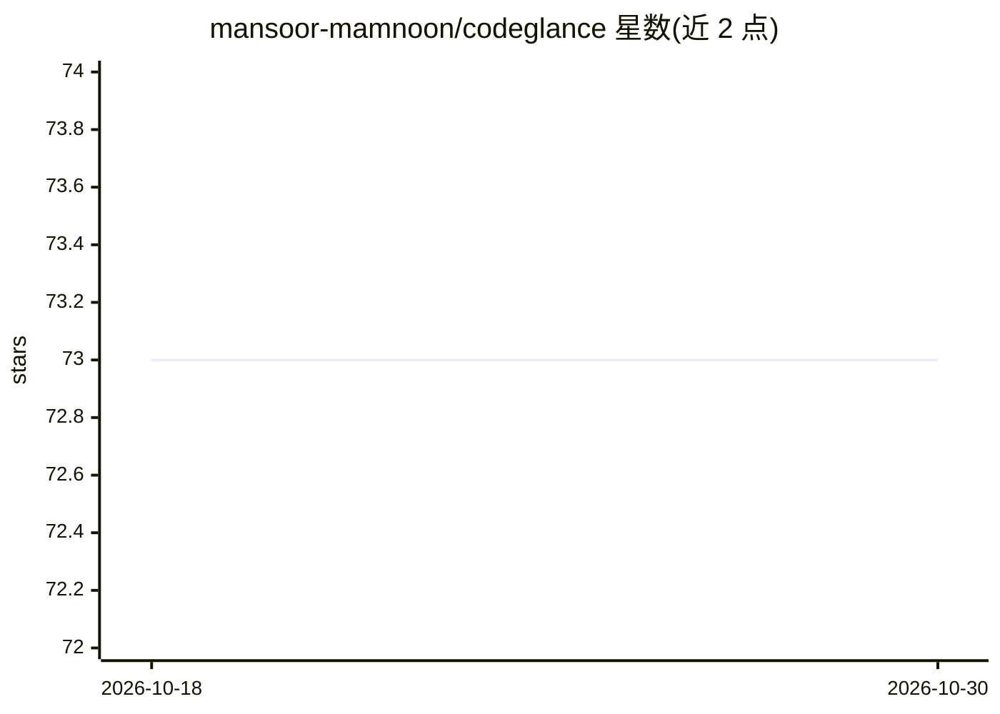

# mansoor-mamnoon/codeglance

⭐ 73 · TypeScript · MIT · 推送 2026-06-03 · [GitHub](https://github.com/mansoor-mamnoon/codeglance) · [官网](https://www.npmjs.com/package/codeglance) · 个人维护

**一条命令生成代码仓库导览与 LLM 上下文简报的 CLI 工具**

面向开发者的仓库导览工具：读取 manifest 文件与文件结构，输出框架识别、运行/构建/测试命令、入口点、优先阅读文件、CI/Docker 工具信息，支持终端、Markdown、JSON 三种输出。--for-ai 模式生成通常少于 300 token 的结构化上下文简报，供粘贴给 Claude/GPT/Gemini 使用。明确声明不做生成、不做推理、不调用 API，纯静态启发式分析。支持 Node.js/Python/Go/Rust/C++/Java/Terraform 七类生态，Ruby/PHP 未支持，超过 25,000 文件的仓库截断。无需安装与配置，npx 直接运行。

## 筛选速览

| 维度 | 判定 | 备注 |
|---|---|---|
| AI 角色 | `ai-ecosystem` | LLM/agent 周边工具 |
| 许可风险 | `permissive` | MIT |
| 部署形态 | `library` | 以包/库形式分发 |
| 模型依赖 | — | README 未给出锁定关系 |
| 硬件要求 | — | 无带数字的原话,不猜 |
| 安装摩擦 | `medium` | 含编译或系统依赖之一 |
| 成熟度 | — | 结构信号不足 |

## 能力要点

- 框架识别、运行命令、入口点与优先阅读文件一站式输出
- --for-ai 生成少于 300 token 的无源码 LLM 上下文简报
- 支持 7 类生态的 manifest 检测（Node.js/Python/Go/Rust/C++/Java/Terraform）
- npx 零安装零配置运行，无需 API key

## 适用场景

- 接手新代码库时快速了解结构、框架与运行方式
- 在向 Claude/Copilot 提问前生成紧凑的上下文简报
- 为团队生成并维护可入库的 onboarding 文档

## 场景标签

 · 领域:开发者工具/静态分析

## 证据(README 行号)

> L43: **Not an AI agent.** No generation, no inference, no API calls. It reads manifest files and file structure, then re

## 星数曲线

2026-10-18 73 → 2026-10-30 73（+0）

---
*卡片 v1 · prompt 1.4 · 生成 2026-10-24 · 置信度 high · 依据 README sha `eeef261ebaea` · [字段定义](../../DATASET.md)*
