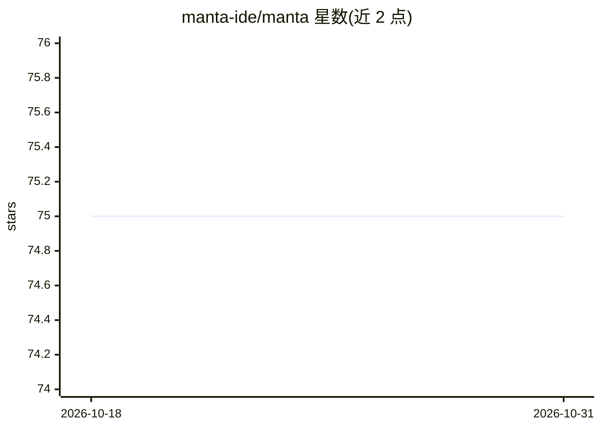

# manta-ide/manta

⭐ 75 · TypeScript · MIT · 推送 2026-08-25 · [GitHub](https://github.com/manta-ide/manta) · [官网](https://getmanta.ai/) · 组织维护

**基于节点图的低代码 IDE：用自然语言节点指挥 AI 编程**

以 React/TypeScript 与图界面（react-flow）构建的开发环境：用户创建自然语言节点并把 AI（Claude Code）导向构建这些节点，形成可编辑的有状态系统。节点软结构化，可任意连接，用于绘制架构图、用户流或功能图；节点属性仅用于指挥编码 agent 做具体修改；通过 agent 建立索引以支持不同抽象层级查看与模块依赖检查。需先安装并配置 Anthropic 的 Claude Code，再经 npm 全局安装运行，浏览器访问 localhost:3000。

## 筛选速览

| 维度 | 判定 | 备注 |
|---|---|---|
| AI 角色 | `ai-ecosystem` | LLM/agent 周边工具 |
| 许可风险 | `permissive` | MIT |
| 部署形态 | `library` | 以包/库形式分发 |
| 模型依赖 | locked-api |  |
| 硬件要求 | — | 无带数字的原话,不猜 |
| 安装摩擦 | `low` | 无编译、无系统依赖或容器化 |
| 成熟度 | — | 结构信号不足 |

## 能力要点

- 自然语言节点 + 任意连接的图结构组织开发内容
- 基于节点/提示生成可编辑属性，用于指挥编码 agent
- 通过 agent 索引支持从架构到函数/变量级的多层级视图
- npm 全局安装，运行 manta 打开本地 Web 界面

## 适用场景

- 用节点图方式规划架构、用户流后再让 AI 生成代码
- 在不同抽象层级查看应用并检查模块依赖以辅助重构
- 以低代码方式指挥 Claude Code 完成具体样式或功能修改

## 场景标签

`编码 Agent` · 领域:编码与开发

## 证据(README 行号)

> L5: Manta IDE is a graph-based development environment that lets you code by creating natural-language nodes.
> L11: 1. Install and setup Claude Code by Anthropic:

## 星数曲线

2026-10-18 75 → 2026-10-31 75（+0）

---
*卡片 v1 · prompt 1.4 · 生成 2026-10-24 · 置信度 high · 依据 README sha `46468dcf29b0` · [字段定义](../../DATASET.md)*
