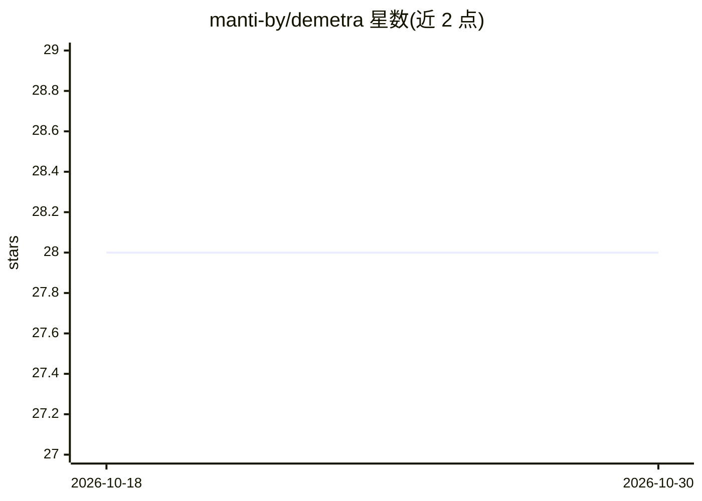

# manti-by/demetra

⭐ 28 · Python · AGPL-3.0 · 推送 2026-10-27 · [GitHub](https://github.com/manti-by/demetra) · 个人维护

**面向开发者的多 AI agent 协同自动化开发平台**

一个自主编码平台，协调多个 AI agent 自动化软件开发流程：从 Linear issue 拉取任务，通过 OpenCode 执行计划/构建/评审环节，自动处理评审 agent 的反馈、lint（Ruff）与测试（pytest）错误，使用 Git worktree 隔离功能开发，并以 PostgreSQL 持久化会话与状态，最终产出 pull request。面向希望将 issue-to-PR 流程自动化的开发团队。安装方式为 uv sync 安装依赖并通过环境变量配置，README 未提供桌面构建或 Docker 镜像。

## 筛选速览

| 维度 | 判定 | 备注 |
|---|---|---|
| AI 角色 | `ai-ecosystem` | LLM/agent 周边工具 |
| 许可风险 | `viral` | AGPL-3.0 |
| 部署形态 | `None` |  |
| 模型依赖 | — | README 未给出锁定关系 |
| 硬件要求 | — | 无带数字的原话,不猜 |
| 安装摩擦 | `low` | 无编译、无系统依赖或容器化 |
| 成熟度 | — | 结构信号不足 |

## 能力要点

- 从 Linear issue 到 pull request 的工作流编排
- OpenCode 集成：AI 驱动的计划、构建与评审
- Build Loop：自动解决评审发现、lint 与测试错误
- Git worktree 隔离开发 + PostgreSQL 状态持久化

## 适用场景

- 把 issue 自动转化为可评审的 pull request
- 让多个 AI agent 分工完成计划、构建与代码评审
- 自动循环修复 lint 与测试错误直至通过

## 场景标签

`编码 Agent` `多智能体` `代码审查` · 领域:Agent 开发

## 证据(README 行号)

> L6: An autonomous coding platform that coordinates multiple AI agents to automate software development. Integrates Linea
> L13: - **OpenCode Integration**: AI-powered planning, building and review.

## 星数曲线

2026-10-18 28 → 2026-10-30 28（+0）

---
*卡片 v1 · prompt 1.4 · 生成 2026-10-26 · 置信度 mid · 依据 README sha `1f209382e77e` · [字段定义](../../DATASET.md)*
