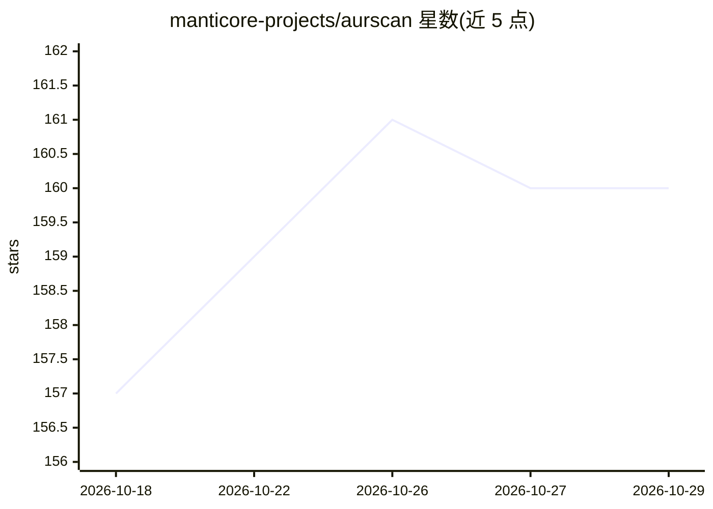

# manticore-projects/aurscan

⭐ 160 · Go · NOASSERTION · 推送 2026-10-17 · [GitHub](https://github.com/manticore-projects/aurscan) · [官网](https://manticore-projects.com/aurscan/README.html) · 组织维护

**Arch 用户：构建前自动扫描 AUR 包是否含恶意代码的 LLM 安全门**

针对 AUR 供应链攻击的 CLI 安全工具：在 yay/paru 下载之后、makepkg 执行之前，读取 PKGBUILD、.install 脚本、.SRCINFO 与辅助脚本，两阶段判定——离线静态规则匹配已知攻击签名，再由 LLM（Claude Code、Anthropic API、Codex、任意 OpenAI 兼容本地端点等）结合 AUR 信誉做判断；无后端时静态规则仍给出 fail-closed 判定。非 OK 判定阻断构建，无终端时默认拒绝。通过自带签名 pacman 仓库、makepkg 或 install.sh 安装单个静态二进制。

## 筛选速览

| 维度 | 判定 | 备注 |
|---|---|---|
| AI 角色 | `ai-native` | 本体是模型或模型工具 |
| 许可风险 | `none` | NOASSERTION |
| 部署形态 | `library` | 以包/库形式分发 |
| 模型依赖 | local-ok | 支持本地模型 |
| 硬件要求 | — | 无带数字的原话,不猜 |
| 安装摩擦 | `low` | 无编译、无系统依赖或容器化 |
| 成熟度 | — | 结构信号不足 |

## 能力要点

- 在下载后、构建前拦截 yay/paru 的 AUR 构建
- 静态规则 + LLM 两阶段判定，完全离线时规则仍 fail-closed
- 多后端自动检测与故障转移链（Claude/Codex/本地 OpenAI 兼容端点/自定义命令）
- 一个静态二进制提供 aurscan、syay、sparu、aurscan-edit 四个入口

## 适用场景

- 日常用 yay/paru 装 AUR 包时自动筛查恶意构建脚本
- 离线或无 API key 环境下依赖静态规则拦截已知攻击签名
- 构建前发现隐藏在 .install 脚本或 source 条目中的载荷

## 场景标签

`网络安全` · 领域:学习与行业

## 证据(README 行号)

> L5: A Claude, Codex, or local model reads the `PKGBUILD` for you and blocks the build if it looks hostile.
> L29: Two stages do the work. Fast, offline **static rules** catch the known campaign signatures at zero cost. Then a **m
> L197: 4. **Local or self-hosted model** via `AURSCAN_OPENAI_URL` — any OpenAI-compatible `/chat/completions` endpoint (l

## 星数曲线

2026-10-18 157 → 2026-10-29 160（+3）

---
*卡片 v1 · prompt 1.4 · 生成 2026-10-22 · 置信度 mid · 依据 README sha `016d315ccdd4` · [字段定义](../../DATASET.md)*
