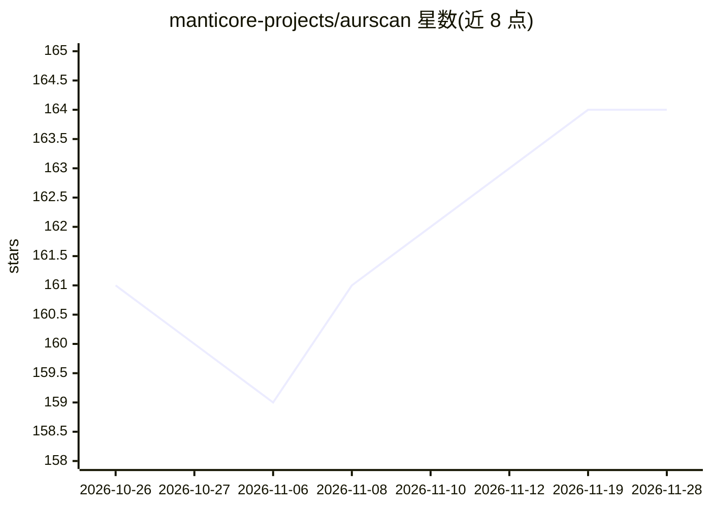

# manticore-projects/aurscan

⭐ 164 · Go · NOASSERTION · 推送 2026-11-22 · [GitHub](https://github.com/manticore-projects/aurscan) · [官网](https://manticore-projects.com/aurscan/README.html) · 组织维护

**安装前用 LLM 扫描 AUR 包构建脚本的恶意代码检测器**

面向 Arch Linux AUR 用户的安装前安全扫描器：在 yay/paru 下载包之后、makepkg 执行之前拦截，读取 PKGBUILD、.install 脚本、.SRCINFO 与辅助脚本，先由离线静态规则匹配已知攻击签名，再交由模型结合 AUR 信誉做判定，恶意则中止构建。支持 Claude Code CLI、ANTHROPIC_API_KEY、Codex CLI、任意 OpenAI 兼容端点及自定义后端组成的降级链，无模型时静态规则仍 fail-closed。通过自签名 pacman 仓库或源码构建安装，以 yay/paru hook 或 wrapper 接入。README 声明其为额外防护层而非保证，需配合 clean chroot 使用。

## 筛选速览

| 维度 | 判定 | 备注 |
|---|---|---|
| AI 角色 | `ai-native` | 本体是模型或模型工具 |
| 许可风险 | `none` | NOASSERTION |
| 部署形态 | `library` | 以包/库形式分发 |
| 模型依赖 | local-ok | 支持本地模型 |
| 硬件要求 | — | 无带数字的原话,不猜 |
| 安装摩擦 | `low` | 无编译、无系统依赖或容器化 |
| 成熟度 | — | 结构信号不足 |

## 能力要点

- 静态规则与 LLM 两阶段判定，无模型配置时静态规则仍返回 fail-closed 结果
- 多后端自动探测与降级链（Claude Code CLI / ANTHROPIC_API_KEY / Codex CLI / OpenAI 兼容端点 / 自定义可执行）
- 通过 yay v13+ Lua hook、syay/sparu wrapper 或 paru PreBuildCommand 在下载后、构建前拦截
- 签名 pacman 仓库提供 x86_64 与 aarch64 二进制，可经 yay/paru 常规升级

## 适用场景

- 安装来路不明的 AUR 包前自动审查 PKGBUILD 与安装脚本
- 系统全量升级时自动扫描每个 AUR 包及其依赖
- 离线或纯内网环境下仅用静态规则拦截已知攻击签名

## 场景标签

`网络安全` · 领域:学习与行业

## 证据(README 行号)

> L5: A Claude, Codex, or local model reads the `PKGBUILD` for you and blocks the build if it looks hostile.
> L16: Reading a PKGBUILD yourself only catches the attacks you already recognise. aurscan reads the package's `PKGBUILD`,
> L197: 4. **Local or self-hosted model** via `AURSCAN_OPENAI_URL` — any OpenAI-compatible `/chat/completions` endpoint (l

## 星数曲线

2026-10-26 161 → 2026-11-28 164（+3）

---
*卡片 v1 · prompt 1.4 · 生成 2026-11-27 · 置信度 mid · 依据 README sha `9a7d487912d2` · [字段定义](../../DATASET.md)*
