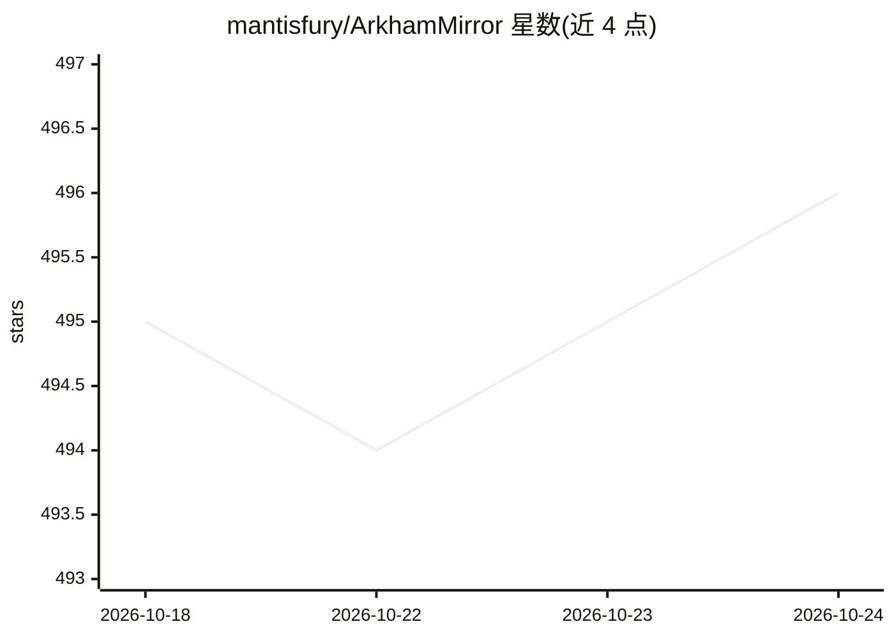

# mantisfury/ArkhamMirror

⭐ 496 · Python · MIT · 推送 2026-01-25 · [GitHub](https://github.com/mantisfury/ArkhamMirror) · 个人维护

**本地优先的调查性文档情报分析平台**

面向调查性研究的模块化平台：以不可变 Frame（17 个服务）加可插拔 shard 组成，覆盖多格式文档摄取（PDF/DOCX/图像/HTML）、OCR（PaddleOCR 与 Vision LLM）、解析分块、嵌入、spaCy 实体抽取，以及 ACH 假设分析、矛盾检测、模式识别、可信度评估、图谱与时间线可视化、媒体取证等分析能力。LLM 通过 OpenAI 兼容服务接入本地（LM Studio/Ollama/vLLM）或云端（OpenAI/Groq）端点，支持一键切换；无 AI/GPU 时优雅降级仍可运行。数据本地存储（PostgreSQL + pgvector），无遥测。

## 筛选速览

| 维度 | 判定 | 备注 |
|---|---|---|
| AI 角色 | `ai-native` | 本体是模型或模型工具 |
| 许可风险 | `permissive` | MIT |
| 部署形态 | `self-host` | docker 或自建部署 |
| 模型依赖 | local-ok | 支持本地模型 |
| 硬件要求 | — | 无带数字的原话,不猜 |
| 安装摩擦 | `low` | 无编译、无系统依赖或容器化 |
| 成熟度 | — | 结构信号不足 |

## 能力要点

- 本地优先架构：PostgreSQL+pgvector 存储，无遥测与云依赖
- 26 个已实现 shard 覆盖摄取→抽取→组织→分析→导出全流程
- LLM 服务兼容 LM Studio/Ollama/vLLM/OpenAI/Groq，一键切换
- ACH 矩阵分析、矛盾检测、欺骗检测清单（MOM/POP/MOSES/EVE）等结构化分析技术

## 适用场景

- 调查记者对大量文档做实体抽取、矛盾检测与假设分析
- 在离线/隔离环境（air-gapped）中完成文档情报分析
- 生成 FOIA 请求、调查报告与完整调查证据包

## 场景标签

`OCR` `文档解析` `RAG` `知识图谱` · 领域:知识与检索

## 证据(README 行号)

> L5: **A modular, local-first platform for document analysis and investigative research**
> L17: Configure local or cloud LLM providers with one-click switching between LM Studio, Ollama, OpenAI, Groq, and custom
> L110: |**AI Junior Analyst**|LLM-powered analysis across all shards - anomaly detection, contradiction finding, pattern 

## 星数曲线

2026-10-18 495 → 2026-10-24 496（+1）

---
*卡片 v1 · prompt 1.4 · 生成 2026-10-21 · 置信度 high · 依据 README sha `0d87a9b1453e` · [字段定义](../../DATASET.md)*
