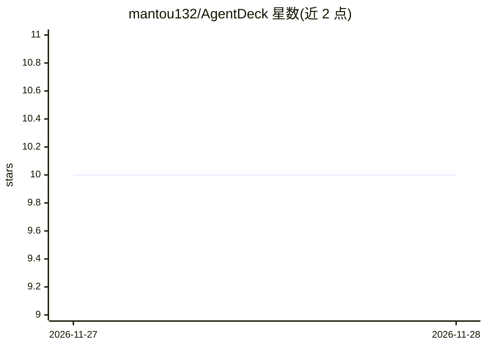

# mantou132/AgentDeck

⭐ 10 · TypeScript · MIT · 推送 2026-11-27 · [GitHub](https://github.com/mantou132/AgentDeck) · [官网](https://agentdeck.xianqiao.wang) · 个人维护 · 中文 README

**在手机上远程控制与审批电脑端编码 Agent 的应用**

由手机 App 与运行在电脑上的守护进程 agentdeckd 组成：在电脑上运行 Claude Code、Codex、Cursor 等 ACP 协议 Agent，通过中继以端到端加密方式从手机启动会话、审批权限请求、查看 Git diff、预览 HTML 产物与模拟器画面，支持按键通话语音交互与任务完成推送。守护进程提供 start/stop/reset 等命令，可经 custom_agents.json 注册额外 Agent，中继可自托管。

## 筛选速览

| 维度 | 判定 | 备注 |
|---|---|---|
| AI 角色 | `ai-ecosystem` | LLM/agent 周边工具 |
| 许可风险 | `permissive` | MIT |
| 部署形态 | `library` | 以包/库形式分发 |
| 模型依赖 | — | README 未给出锁定关系 |
| 硬件要求 | — | 无带数字的原话,不猜 |
| 安装摩擦 | `low` | 无编译、无系统依赖或容器化 |
| 成熟度 | — | 结构信号不足 |

## 能力要点

- 支持 ACP 协议的多 Agent 统一接入与切换
- 端到端加密，中继只转发密文，支持自托管
- 手机端审批权限请求、浏览 diff 与实时预览模拟器/浏览器画面
- custom_agents.json 注册任意 ACP Agent 或本地命令

## 适用场景

- 离开电脑时在手机上启动、引导并审批编码 Agent
- 在手机上查看 Agent 产生的文件改动与页面预览
- 团队需要自托管中继并管理 Agent 设备接入

## 场景标签

`编码 Agent` · 领域:编码与开发

## 证据(README 行号)

> L3: **Your agents, in your pocket.** Run Claude Code, Codex, Cursor or any ACP agent on your own computer, and start, st
> L31: - **One app for every agent.** Claude Code, Codex, Cursor, GitHub Copilot, Google Antigravity, OpenCode, Qwen Code,

## 星数曲线

2026-11-27 10 → 2026-11-28 10（+0）

---
*卡片 v1 · prompt 1.4 · 生成 2026-11-27 · 置信度 high · 依据 README sha `d0fbd86352b4` · [字段定义](../../DATASET.md)*
