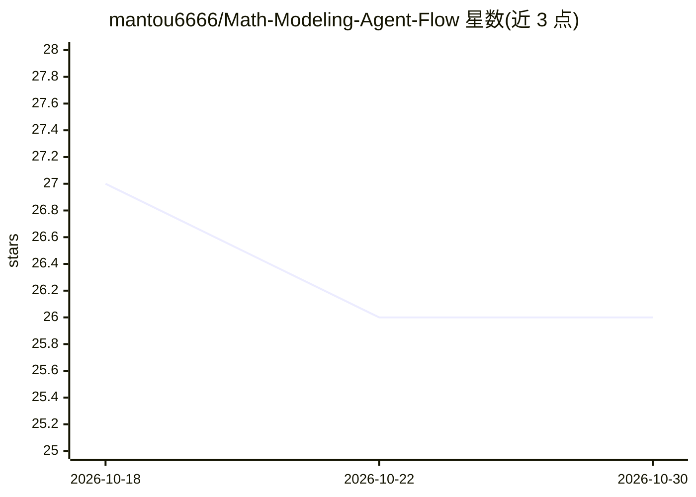

# mantou6666/Math-Modeling-Agent-Flow

⭐ 26 · Python · MIT · 推送 2026-08-20 · [GitHub](https://github.com/mantou6666/Math-Modeling-Agent-Flow) · 个人维护 · 中文 README

**数学建模竞赛（国赛/美赛）四阶段 AI Agent 工作流技能包**

面向 CUMCM/MCM-ICM 参赛者的四个 AI Skills：Solver 负责读题、发散候选方案、求解与主动攻击结果验证；Paper 将已确认的建模成果整理成论文主线，保持正文、公式、图表与结果一致；Finalizer 在提交前检查关键数字、附件、文件完整性与版本一致性，冻结确认内容；Growth 赛后复盘整理可复用经验。各阶段通过 Handoff 传递已确认信息以防事实漂移，可单独使用或按流程串联，通过 npx skills 安装到 Claude Code、Codex 等 agent 环境。README 明确声明不替代参赛者最终判断。

## 筛选速览

| 维度 | 判定 | 备注 |
|---|---|---|
| AI 角色 | `ai-ecosystem` | LLM/agent 周边工具 |
| 许可风险 | `permissive` | MIT |
| 部署形态 | `library` | 以包/库形式分发 |
| 模型依赖 | — | README 未给出锁定关系 |
| 硬件要求 | — | 无带数字的原话,不猜 |
| 安装摩擦 | `low` | 无编译、无系统依赖或容器化 |
| 成熟度 | — | 结构信号不足 |

## 能力要点

- 四阶段流水线 Solver→Paper→Finalizer→Growth，各 Skill 可独立使用
- Solver 先发散多候选方案再通过查证、求解、验证逐步收敛
- Finalizer 检查关键数字、附件与版本一致性，确认内容进入冻结状态
- 通过 Handoff 传递已确认信息，减少长任务中的事实漂移

## 适用场景

- 数学建模比赛中从读题、建模到论文写作的全流程辅助
- 提交前核对论文数字、图表、附件与版本一致性
- 比赛结束后复盘并沉淀可复用经验

## 场景标签

`AI 写作` · 领域:内容生成

## 证据(README 行号)

> L3: > **AI Agent workflow for mathematical modeling competitions (CUMCM 国赛 / MCM-ICM 美赛). Solver → Paper → Finalizer → G
> L196: 四个 Skill 可以分别安装。直接交给你的agent叫他帮你安装即可。（Claude code，codex等均可使用）
> L201: npx skills@latest add mantou6666/Math-Modeling-Agent-Flow --skill math-modeling-solver --global --yes

## 星数曲线

2026-10-18 27 → 2026-10-30 26（-1）

---
*卡片 v1 · prompt 1.4 · 生成 2026-10-26 · 置信度 high · 依据 README sha `c3adce0b59f7` · [字段定义](../../DATASET.md)*
